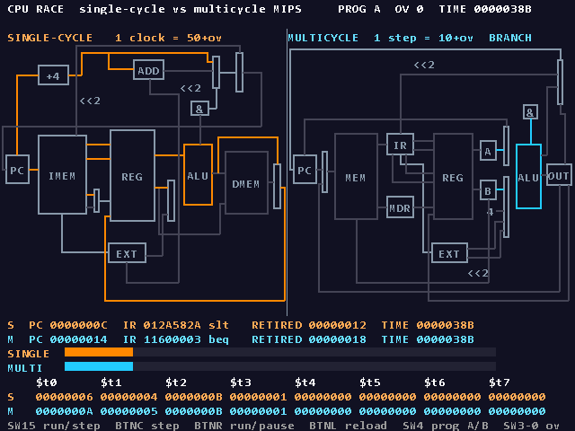
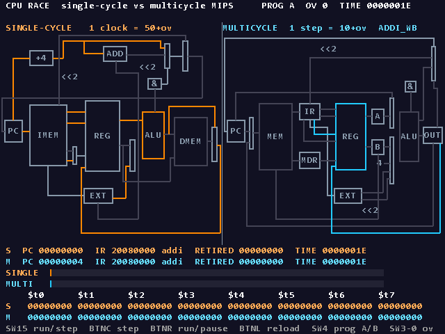
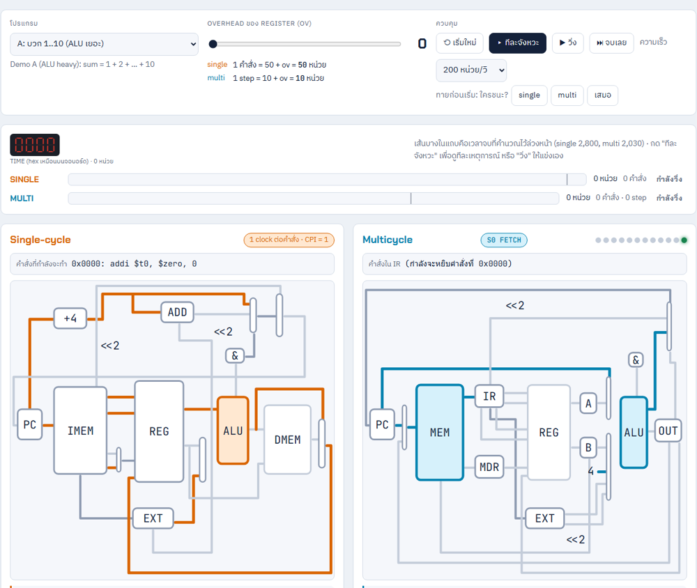

# CPU Race: Single-cycle vs Multicycle MIPS บน FPGA

CPU MIPS **2 แบบ** (single-cycle กับ multicycle) ที่เขียนเองด้วย **Verilog** ใส่ลงชิป FPGA ตัวเดียวกันบนบอร์ด **Digilent Nexys A7-100T** รันโปรแกรมเดียวกันพร้อมกัน แล้ววาด datapath ของทั้งคู่ขึ้น **จอ VGA** แบบสด เส้นที่ข้อมูลกำลังวิ่งผ่านจะติดสี และแข่งกันว่าใครจบก่อน **ตามเวลาจริง ไม่ใช่ตามจำนวน clock**



> ภาพนี้ไม่ใช่ภาพวาด แต่เป็นภาพที่วงจรสร้างจริง ได้จากการจำลอง `rtl/top.v` ทั้งตัวด้วย `python sim/vga_frame.py`

**คำถามที่โปรเจคนี้ตอบ:** CPU ตัวหนึ่งใช้ 1 clock ต่อคำสั่ง อีกตัวใช้ 3–5 clock ต่อคำสั่ง ตัวไหนเร็วกว่า?
คำตอบคือ "แล้วแต่" เพราะเวลาจริง = **IC × CPI × T** multicycle ใช้ clock มากกว่าแต่ clock สั้นกว่า และถ้า overhead ของ register สูงพอ ผลจะพลิกกลับ

> วิชา Computer Architecture · ภาควิชาวิศวกรรมคอมพิวเตอร์ มหาวิทยาลัยขอนแก่น · กลุ่ม 19

---

## สารบัญ

- [ลองใช้เลย](#ลองใช้เลย)
- [ผลการแข่ง](#ผลการแข่ง)
- [ใช้อะไรสร้าง](#ใช้อะไรสร้าง)
- [ภาพรวมระบบ](#ภาพรวมระบบ)
- [ฮาร์ดแวร์: แต่ละส่วนทำอะไร](#ฮาร์ดแวร์-แต่ละส่วนทำอะไร)
- [เครื่องมือ Python](#เครื่องมือ-python)
- [ข้อมูลไหลจากโปรแกรมถึงจอยังไง](#ข้อมูลไหลจากโปรแกรมถึงจอยังไง)
- [การทดสอบ](#การทดสอบ)
- [ลงบอร์ดจริง](#ลงบอร์ดจริง)
- [เว็บ](#เว็บ)
- [โครงสร้างโฟลเดอร์](#โครงสร้างโฟลเดอร์)
- [สร้างขึ้นมายังไง](#สร้างขึ้นมายังไง)
- [สถานะและข้อจำกัด](#สถานะและข้อจำกัด)
- [เอกสารเพิ่มเติม](#เอกสารเพิ่มเติม)

---

## ลองใช้เลย

### 1. ไม่มีอะไรเลยนอกจากเบราว์เซอร์

ดับเบิลคลิก [`cpu-race/web/index.html`](cpu-race/web/index.html) (Chrome หรือ Edge) ไม่ต้องติดตั้ง ไม่ต้องต่อเน็ต จะเห็น single vs multi แข่งกันทีละ step ด้วยภาพ datapath เดียวกับจอ VGA

### 2. จำลองวงจรในคอม (ไม่ต้องมีบอร์ด)

ต้องมี Python 3 + Pillow และ [Icarus Verilog](https://bleyer.org/icarus/) 12 อยู่ใน PATH

```
cd cpu-race
python sim/run_all.py                       รันเทสต์ทั้งหมด ต้องได้ ALL PASS
python sim/vga_frame.py --prog B --ov 4     ถ่ายภาพจอ VGA ที่วงจรสร้าง → build/frames/
python sim/trace.py programs/examples/ex_lw_add.s   ดูโปรแกรมวิ่งทีละ step
python tools/race_calc.py programs/demoA_alu_heavy.s ตารางเวลาแข่งทุกค่า ov
```

### 3. ลงบอร์ด Nexys A7-100T

ต้องมี Vivado 2025.2 (รุ่น ML Standard ฟรี)

```
cd cpu-race
fpga\run.bat smoke program     ทดสอบบอร์ดก่อน (สวิตช์ → LED, 7-seg นับ)
fpga\run.bat top program       ตัวเต็ม แล้วต่อจอ VGA
```

วิธีเล่นบนบอร์ดอยู่ใน [`cpu-race/docs/demo_script.md`](cpu-race/docs/demo_script.md)

---

## ผลการแข่ง

มีโปรแกรม demo 2 ตัวฝังในบอร์ด (เลือกด้วย SW4) และปรับ **ov** (register overhead 0–15) ได้ด้วย SW3–0

| | โปรแกรม A (ALU heavy) | โปรแกรม B (Memory heavy) |
|---|---|---|
| ทำอะไร | บวก 1 + 2 + … + 10 = 55 | รวม array 8 ตัวด้วย `lw` = 31 |
| จำนวนคำสั่ง (IC) | 56 | 37 |
| CPI ของ multicycle | 3.63 | 3.97 |
| multicycle ชนะเมื่อ | ov ≤ 5 | ov ≤ 3 |
| ที่ ov = 0 | single 2800 vs **multi 2030** | single 1850 vs **multi 1470** |
| ที่ ov = 4 | single 3024 vs **multi 2842** | **single 1998** vs multi 2058 |
| ที่ ov = 6 | **single 3136** vs multi 3248 | **single 2072** vs multi 2352 |

ov เท่ากัน แต่โปรแกรมต่างกัน ผลกลับกันได้ เพราะ `lw` ใช้ 5 step ใน multicycle ทำให้โปรแกรมที่มี `lw` เยอะมี CPI สูง

ตัวเลขทั้งหมดมาจาก `tools/race_calc.py` และยืนยันด้วยการจำลองทั้งบอร์ดใน `sim/run_all.py`

---

## ใช้อะไรสร้าง

| ใช้ทำอะไร | ภาษา / เครื่องมือ |
|---|---|
| ตัววงจร (CPU, จอ, ปุ่ม, UART) | **Verilog** (`rtl/`) |
| จำลองวงจรบนคอม | **Icarus Verilog** + **GTKWave** สำหรับดู waveform |
| Assembler, ตัวจำลองอ้างอิง, สร้างภาพจอ, รันเทสต์ | **Python 3** (`tools/`, `sim/`) |
| สังเคราะห์วงจรและโหลดลงบอร์ด | **Vivado 2025.2** สั่งด้วยสคริปต์ **Tcl** แบบ non-project mode (`fpga/`) |
| เว็บจำลองและเว็บคุยกับบอร์ด | **HTML + JavaScript** (`web/`, `web-live/`) |
| บอร์ด | **Digilent Nexys A7-100T** ชิป Xilinx Artix-7 XC7A100T, clock 100 MHz |
| ตัวตรวจคำตอบ | **cpuSim** ของอาจารย์และพี่ TA (Python, รุ่น V7) |

---

## ภาพรวมระบบ

```
                    ┌──────────────── ชิป FPGA (rtl/top.v) ──────────────────┐
 สวิตช์/ปุ่ม ──► debounce ──► race_ctrl (นาฬิกาเวลาร่วม)                     │
                    │              │ enable ทุก 50+ov   │ enable ทุก 10+ov    │
                    │              ▼                    ▼                     │
 boot_rom ──► mem_loader ──► single_cycle_cpu      multi_cycle_cpu          │
 (โปรแกรม A/B)    (copy)          │ active, pc, reg    │ active, state, reg  │
                    │              └─────────┬──────────┘                     │
                    │                        ▼                                │
                    │                vga_renderer ───────────────────────────►│──► จอ VGA 640×480
                    │                sevenseg / LED ─────────────────────────►│──► 7-seg, LED
 คอม (เว็บ) ◄─USB──► uart_rx / uart_tx / uart_cmd                             │
                    └──────────────────────────────────────────────────────┘
```

- ทั้งระบบใช้ **clock 25 MHz ตัวเดียว** จึงไม่มีปัญหาข้าม clock domain
- CPU **ไม่ได้เดินทุก clock** แต่เดินเมื่อ `race_ctrl` ส่ง enable ให้

### โมเดลเวลา (หัวใจของงาน)

บนบอร์ดทั้งสอง CPU ใช้ clock จริงตัวเดียวกัน ถ้าปล่อยให้เดินทุก clock จะไม่เห็นว่า clock ของ single-cycle ยาวกว่า `race_ctrl` จึงจำลอง "เวลา" แยกออกมา:

| | เวลาต่อครั้ง | เหตุผล |
|---|---|---|
| Single-cycle | 1 คำสั่ง = **50 + ov** หน่วย | clock ต้องยาวพอสำหรับคำสั่งที่ช้าที่สุด (`lw`: IMEM → REG → ALU → DMEM → REG = 5 ช่วง × 10) และเสีย ov ครั้งเดียว |
| Multicycle | 1 step = **10 + ov** หน่วย | step สั้น แต่เสีย ov ทุก step |

**ov** คือเวลาที่เสียทุกครั้งที่ข้อมูลผ่าน register เช่น setup time, clock-to-Q และ clock skew

- **Step mode (SW15 = 0):** กด BTNC แล้วเวลาจะกระโดดไปเหตุการณ์ถัดไป
- **Run mode (SW15 = 1):** เวลาเดินเองตามความเร็วที่ตั้ง ใครถึงคำสั่ง `halt` ก่อนคือผู้ชนะ

---

## ฮาร์ดแวร์: แต่ละส่วนทำอะไร

ทุกไฟล์อยู่ใน [`cpu-race/rtl/`](cpu-race/rtl/)

### ชุดคำสั่ง (ISA)

MIPS 10 คำสั่ง เป็น subset ตามสไลด์ w04c แล้วเพิ่ม `addi`: `add sub and or slt addi lw sw beq j`
โปรแกรมจบเมื่อเจอ `halt: j halt` (คำสั่งที่กระโดดหาตัวเอง)

| ช่วง address | ใช้ทำอะไร |
|---|---|
| `0x000–0x3FF` | โปรแกรม (256 word) |
| `0x400–0x7FF` | ข้อมูล (256 word) |

ทั้งสอง CPU ใช้ memory map เดียวกัน โปรแกรมเดียวกันจึงให้ผลเหมือนกัน

### `common/`: ชิ้นส่วนที่ใช้ร่วมกันทั้งสอง CPU

| ไฟล์ | ทำอะไร |
|---|---|
| `alu.v` | บวก ลบ AND OR slt และบอกว่าผลเป็นศูนย์ไหม (ใช้กับ `beq`) |
| `alu_control.v` | แปลง ALUOp + funct เป็นคำสั่งของ ALU ตามตารางในสไลด์ w04a |
| `regfile.v` | register 32 ตัว อ่าน 2 ช่อง เขียน 1 ช่อง และมีช่องอ่านพิเศษให้จอดึงค่า `$t0–$t7` ไปโชว์ |
| `sign_ext.v` | ขยายเลข 16 bit เป็น 32 bit แบบมีเครื่องหมาย |

### `single/`: Single-cycle CPU

| ไฟล์ | ทำอะไร |
|---|---|
| `single_cycle_cpu.v` | datapath ตามสไลด์ w04a: PC, IMEM, REG, ALU, DMEM, mux และ adder สำหรับ PC+4 กับ branch |
| `sc_control.v` | main control ดู opcode แล้วตั้ง RegDst, ALUSrc, MemtoReg, RegWrite, MemWrite, Branch, Jump, ALUOp |

ทำ **1 คำสั่ง** ต่อ 1 enable (CPI = 1)

### `multi/`: Multicycle CPU

| ไฟล์ | ทำอะไร |
|---|---|
| `multi_cycle_cpu.v` | datapath ตามสไลด์ w04c หน้า 3: memory ก้อนเดียว ALU ตัวเดียว และ register คั่น (IR, MDR, A, B, ALUOut) |
| `mc_fsm.v` | FSM **12 state** ขยายจากตาราง 5 step ในสไลด์ w04c หน้า 4 โดยเพิ่ม state ของ `addi` 2 ตัว |

ทำ **1 step** ต่อ 1 enable จำนวน step คือ `lw` 5, R-type / `sw` / `addi` 4, `beq` / `j` 3

### `mem/`: หน่วยความจำ

| ไฟล์ | ทำอะไร |
|---|---|
| `lutram.v` | memory ของ CPU แบบ **อ่านได้ทันที** (async read) Vivado แปลงเป็น LUTRAM ให้เอง |
| `boot_rom.v` | เก็บโปรแกรม demo A และ B ฝังไว้ตอน build (ใช้ BRAM) |
| `mem_loader.v` | ตอนรีเซ็ตหรือกด BTNL จะ copy โปรแกรม 512 word ลง memory ของ **ทั้งสอง CPU** |

**ทำไมไม่ใช้ BRAM กับ CPU:** single-cycle ต้องอ่านคำสั่งและข้อมูลให้เสร็จใน clock เดียว แต่ BRAM ให้ข้อมูลช้าไป 1 clock

### `race/`: ตัวคุมการแข่ง

`race_ctrl.v` เป็นนาฬิกาเวลาร่วม ส่ง enable ให้แต่ละ CPU ตามโมเดลเวลาด้านบน และจำเวลาที่แต่ละตัวจบไว้

### `io/` และ clock

| ไฟล์ | ทำอะไร |
|---|---|
| `clk_gen.v` | แปลง 100 MHz เป็น 25 MHz ด้วย MMCM ในชิป |
| `debounce.v` | กันปุ่มเด้ง แล้วปล่อยสัญญาณ 1 clock ต่อการกดหนึ่งครั้ง |
| `sevenseg.v` | สแกน 7-seg 8 หลักทีละหลัก โชว์เลข hex |
| `uart_rx.v`, `uart_tx.v`, `uart_cmd.v` | คุยกับคอมผ่าน USB-UART 115200 bps: รับคำสั่ง step / run / reset / เลือกโปรแกรม และส่งแพ็กเก็ตสถานะ ([`docs/protocol.md`](cpu-race/docs/protocol.md)) |

### `vga/`: จอ VGA

| ไฟล์ | ทำอะไร |
|---|---|
| `vga_timing.v` | สร้าง hsync/vsync สำหรับ 640×480 @ 60 Hz |
| `vga_renderer.v` | วาดจอ 3 ชั้น (ด้านล่าง) |

**ชั้นที่ 1: ภาพ datapath แบบ wire-ID**
ภาพพื้นหลังไม่ได้เก็บสี แต่เก็บ **"เลขประจำเส้น"** ของแต่ละเส้นและกล่อง วงจรอ่านเลขทีละ pixel แล้วดูว่าเส้นนั้น active ไหม ถ้า active ระบายส้ม (single) หรือฟ้า (multi) ถ้าไม่ ระบายเทา จึงไม่ต้องวาดเส้นด้วยวงจรเลย
ข้อมูลว่าเส้นไหน active มาจากสัญญาณ `active` ที่แต่ละ CPU คำนวณจาก control signal ของคำสั่งปัจจุบัน (single) หรือจาก state (multi) ดูว่าบิตไหนคือเส้นไหนได้ที่ [`docs/wire_map.md`](cpu-race/docs/wire_map.md)

**ชั้นที่ 2: แถบแข่ง** แสดงความคืบหน้าของแต่ละตัว

**ชั้นที่ 3: ตัวหนังสือ 80×30 ช่อง** template (`text.mem`) บอกว่าช่องไหนเป็นตัวอักษรคงที่ ช่องไหนเป็นค่าสด (PC, เวลา, ชื่อคำสั่ง, ชื่อ state) แล้ววาดด้วยฟอนต์ 8×16 (`font.mem`)



### `top.v`

ต่อทุกชิ้นเข้าด้วยกันแล้วผูกกับขาจริงของบอร์ด ไฟล์ขา (`constr/nexys_a7_100t.xdc`) ไม่ได้พิมพ์เอง แต่สร้างด้วย `tools/make_xdc.py` จากไฟล์ master ของ Digilent

---

## เครื่องมือ Python

ทุกไฟล์อยู่ใน [`cpu-race/tools/`](cpu-race/tools/)

| ไฟล์ | ทำอะไร |
|---|---|
| `asm.py` | **Assembler ที่เขียนเอง:** แปลง `.s` เป็น `.mem` (hex 8 หลัก 512 บรรทัด) |
| `ref_model.py` | **ตัวจำลองอ้างอิง** ใช้เป็น "เฉลย" รันจาก `.mem` แบบเดียวกับฮาร์ดแวร์ |
| `cpusim_adapter.py` | เอาโปรแกรมของเราไปรันบน **cpuSim ของอาจารย์**: แปลงรูปแบบคำสั่ง เติม SUB / AND / OR / SLT ที่ cpuSim ยังไม่มี และแก้บั๊ก ADD โดยครอบจากข้างนอก ไม่แก้ไฟล์ต้นฉบับ |
| `gen_screen.py` | **วาดภาพ datapath ด้วยโค้ด** ให้ทุกเส้นมี wire-ID ได้ `bg.mem` และ template ตัวหนังสือ `text.mem` |
| `gen_font.py` | สร้างฟอนต์ 8×16 เป็น `font.mem` |
| `build_mems.py` | สร้างไฟล์ทั้งหมดใน `mem/` ที่ฝังลงชิป (progA, progB, bg, text, font) |
| `race_calc.py` | คำนวณเวลาแข่งที่ควรได้ทุกค่า ov และหาจุดพลิก |
| `make_xdc.py` | สร้างไฟล์ขาจากไฟล์ master ของ Digilent |
| `build_web.py` | ดึงโปรแกรม `.s` ชุดเดียวกันไปใส่เว็บ |

---

## ข้อมูลไหลจากโปรแกรมถึงจอยังไง

```
programs/demoA_alu_heavy.s ─► asm.py ─► mem/progA.mem ─► (Vivado build) ─► boot_rom ในชิป
                                                                             │ กด BTNL
                                                                             ▼
                                                   mem_loader copy ลง memory ของทั้งสอง CPU
                                                                             │
                                  race_ctrl ส่ง enable ─► CPU เดิน ─► active / pc / register
                                                                             │
gen_screen.py ─► mem/bg.mem + mem/text.mem ─► vga_renderer ◄─────────────────┘ ─► จอ VGA
```

---

## การทดสอบ

ทดสอบทั้งหมดได้บนคอมโดยไม่ต้องมีบอร์ด ด้วยคำสั่งเดียว `python sim/run_all.py`

1. **ทดสอบชิ้นเล็ก:** ALU, alu_control, regfile, sign_ext
2. **เทียบ 4 ทาง:** ทุกโปรแกรม (เทสต์ทีละคำสั่ง 10 ตัว + ตัวอย่าง + demo A/B รวม 13 โปรแกรม) รันบน
   1. `ref_model.py`
   2. cpuSim ของอาจารย์
   3. single-cycle (Verilog)
   4. multicycle (Verilog)

   แล้วเทียบ register 32 ตัว + memory ต้องตรงกันหมด และต้องตรงกับค่าที่เขียนคาดไว้ในไฟล์ (`#! expect`)
3. **จำลองทั้งบอร์ด** (`top.v` ทั้งตัว) แข่ง 6 กรณี เวลาจบต้องตรงสูตร
4. **เทียบเว็บกับวงจร:** `web/engine.js` ต้องตรงกับ asm, ref_model และ RTL
5. **ทดสอบ UART:** `web-live/protocol.js` ตัวเดียวกับที่เว็บใช้ คุยกับ `top.v` ใน simulation

```
[PASS] tb_common (alu, alu_control, regfile, sign_ext)
[PASS] t_add ... demoB_mem_heavy        13 โปรแกรม: cpusim=ref single=ref multi=ref
[PASS] race prog A ov=0 / 5 / 6, prog B ov=3 / 4 / 15
[PASS] web/engine.js เทียบกับ asm/ref_model/RTL
[PASS] UART: เว็บ web-live/protocol.js คุยกับ top.v
ALL PASS
```

เครื่องมือช่วยดูเพิ่มเติม:
- **`sim/trace.py`:** ดูโปรแกรมวิ่งทีละ step และได้ `.vcd` ไปเปิดใน GTKWave
- **`sim/vga_frame.py`:** จำลองทั้งบอร์ดแล้วถ่ายภาพจอ VGA เป็น PNG

---

## ลงบอร์ดจริง

`fpga/run.bat` เรียก Vivado แบบ batch ด้วย `fpga/build.tcl` (non-project mode ไม่มีไฟล์ `.xpr`) ซึ่งอ่าน `rtl/` + `constr/` + `mem/` แล้วทำ synthesis → place → route → bitstream จากนั้น `fpga/program.tcl` โหลดลงบอร์ด ผลและรายงานทั้งหมดอยู่ใน `build/<target>/`

**ผล build ตัวเต็ม (`top`) บน Vivado 2025.2:**

| รายการ | ค่า |
|---|---|
| Error / Critical warning | 0 / 0 |
| Timing ที่ 25 MHz | WNS +19.195 ns, WHS +0.134 ns |
| LUT | 4115 (6.5%) |
| Flip-flop | 2781 |
| LUTRAM | 691 |
| BRAM | 44 / 135 |
| MMCM | 1 |

**ปุ่มและสวิตช์:**

| ปุ่ม / สวิตช์ | ทำอะไร |
|---|---|
| BTNC | step: กระโดดไปเหตุการณ์ถัดไป (SW15 = 0) |
| BTNR | เริ่ม / หยุด การวิ่ง (SW15 = 1) |
| BTNL | โหลดโปรแกรมใหม่ + เวลากลับเป็น 0 |
| BTNU | สลับ 7-seg: จำนวนคำสั่ง / เวลา |
| SW3–0 | ค่า ov (0–15) |
| SW4 | โปรแกรม A (ลง) / B (ขึ้น) |
| SW15 | step (ลง) / run (ขึ้น) |
| SW14–12 | ความเร็วตอน run |

---

## เว็บ



| เว็บ | ทำอะไร |
|---|---|
| [`web/`](cpu-race/web/) **CPU Race Lab** | ใช้ออฟไลน์ ไม่ต้องมีบอร์ด มีตัวจำลอง CPU ใน JavaScript (`engine.js`) ที่ถูกเทียบกับ Verilog แล้ว ประกอบด้วยหน้าแข่งที่ใช้ภาพ datapath เดียวกับจอ VGA, บทเรียน, assembler, เลขฐาน & ถอดรหัส, แบบฝึกสุ่ม และวิธีตั้งสวิตช์บนบอร์ด |
| [`web-live/`](cpu-race/web-live/) **CPU Race Live** | ต่อบอร์ดจริงผ่าน USB ด้วย **Web Serial** (Chrome / Edge) สั่งบอร์ดและดูสถานะสด ถ้าเบราว์เซอร์ไม่ยอมเปิดจากไฟล์ตรงๆ ให้ใช้ `live.bat` |

---

## โครงสร้างโฟลเดอร์

```
cpu-race/
├── rtl/         วงจร Verilog (ของจริงที่ลงบอร์ด)
│   ├── common/    ALU, register file, sign-extend
│   ├── single/    single-cycle CPU
│   ├── multi/     multicycle CPU + FSM
│   ├── mem/       LUTRAM, boot ROM, ตัวโหลดโปรแกรม
│   ├── race/      ตัวคุมการแข่ง
│   ├── io/        ปุ่ม, 7-seg, UART
│   ├── vga/       จอ VGA
│   ├── clk_gen.v  100 → 25 MHz
│   ├── top.v      รวมทุกอย่างลงบอร์ด
│   └── top_smoke.v วงจรทดสอบบอร์ด
├── programs/    โปรแกรม assembly (tests/, examples/, demo A/B)
├── tools/       เครื่องมือ Python (assembler, reference model, สร้างภาพจอ ...)
│   └── third_party/cpusim_v7/  cpuSim ของอาจารย์ (ไม่ได้แก้ไข)
├── sim/         testbench และสคริปต์รันเทสต์
├── mem/         ไฟล์ที่ฝังลงชิป (โปรแกรม, ภาพพื้นหลัง, ฟอนต์, template ตัวหนังสือ)
├── constr/      ไฟล์ขาของบอร์ด (.xdc)
├── fpga/        สคริปต์ Vivado
├── web/         เว็บ CPU Race Lab
├── web-live/    เว็บ CPU Race Live (คุยกับบอร์ด)
├── docs/        เอกสาร
└── build/       ไฟล์ที่เครื่องมือสร้างขึ้น (ไม่ขึ้น git)
```

---

## สร้างขึ้นมายังไง

สร้างจากล่างขึ้นบน และทดสอบทุกชั้นก่อนต่อชั้นถัดไป

1. **เขียนสเปคก่อน** ([`docs/spec.md`](cpu-race/docs/spec.md)): ล็อก ISA, memory map, ตาราง control และโมเดลเวลา
2. **เครื่องมือ:** assembler + reference model + เทสต์ทีละคำสั่ง
3. **ชิ้นส่วนกลาง:** ALU, register file และอื่นๆ แล้วเทสต์ทีละชิ้น
4. **Single-cycle** แล้วเทียบกับ reference model
5. **Multicycle + FSM** แล้วเทียบแบบเดียวกัน
6. **ผูก cpuSim ของอาจารย์** เข้าไปเป็นทางที่ 4
7. **race_ctrl + boot ROM / loader + ปุ่ม / 7-seg**
8. **VGA:** สร้างภาพ wire-ID ด้วย Python แล้วเขียน renderer ตรวจด้วยภาพจาก `vga_frame.py`
9. **รวมใน `top.v`** แล้ว build ลงบอร์ดจริง
10. **เว็บ** ตามด้วย **UART + เว็บสด**

**ปัญหาที่เจอระหว่างทาง:**
- สไลด์ w04c พิมพ์ funct ของ `slt` เป็น `0xA` แต่ค่าจริงคือ `0x2A` (ยืนยันกับ w04a และ cpuSim)
- cpuSim V7 ยังไม่มี SUB / AND / OR / SLT และมีบั๊กใน ADD จึงต้องเขียน adapter ครอบ
- BRAM อ่านช้าไป 1 clock ทำให้ single-cycle อ่านไม่ทัน จึงเปลี่ยนเป็น LUTRAM

---

## สถานะและข้อจำกัด

- ✅ ทั้งระบบผ่านการทดสอบใน simulation (`run_all.py` ALL PASS)
- ✅ build และรันบนบอร์ดจริงได้ ขึ้นภาพบนจอ VGA แล้ว
- ⏳ UART + `web-live/` ผ่านใน simulation แล้ว แต่ยังไม่ได้ลองกับบอร์ดจริง (ต้อง build bitstream ใหม่ที่มี UART)
- ไม่มี overflow exception (`add` / `sub` / `addi` ทำงานเหมือน `addu`), ไม่มี `jal`, `lw` / `sw` ต้องอยู่ในช่วง `0x400–0x7FF`
- ไม่ได้ทำ pipelining ซึ่งเป็นงานต่อยอดได้

---

## เอกสารเพิ่มเติม

| ไฟล์ | อ่านเมื่อ |
|---|---|
| [`cpu-race/README.md`](cpu-race/README.md) | อยากเริ่มใช้เร็วๆ |
| [`docs/tutorial.md`](cpu-race/docs/tutorial.md) | เพิ่งเริ่ม อยากเข้าใจว่า CPU, single-cycle, multicycle คืออะไร |
| [`docs/manual.md`](cpu-race/docs/manual.md) | อยากรันเทสต์ เขียนโปรแกรมเอง ดู waveform หรือโหลดลงบอร์ด |
| [`docs/demo_script.md`](cpu-race/docs/demo_script.md) | ลำดับการเดโม่ ตำแหน่งสวิตช์ และตัวเลขที่ต้องได้ |
| [`docs/spec.md`](cpu-race/docs/spec.md) | สเปคทั้งหมดและการตัดสินใจของโปรเจค |
| [`docs/wire_map.md`](cpu-race/docs/wire_map.md) | บิตไหนของ `active` คือเส้นไหนในภาพ datapath |
| [`docs/protocol.md`](cpu-race/docs/protocol.md) | โปรโตคอล UART ระหว่างเว็บกับบอร์ด |

---

## ผู้จัดทำ

| ชื่อ | รหัสนักศึกษา | หน้าที่ |
|---|---|---|
| [ชื่อ-นามสกุล] | [รหัส] | [หน้าที่] |
| [ชื่อ-นามสกุล] | [รหัส] | [หน้าที่] |
| [ชื่อ-นามสกุล] | [รหัส] | [หน้าที่] |
| [ชื่อ-นามสกุล] | [รหัส] | [หน้าที่] |

## อ้างอิงและขอบคุณ

- สไลด์ประกอบการสอนวิชา Computer Architecture (w01b, w04a, w04c) ของอาจารย์ธัชพงศ์ กตัญญูกุล
- cpuSim (Python simulator) ของอาจารย์และพี่ TA ใช้เป็นตัวตรวจคำตอบ อยู่ใน `tools/third_party/cpusim_v7/` โดยไม่ได้แก้ไข
- ไฟล์ขา [`Nexys-A7-100T-Master.xdc`](https://github.com/Digilent/digilent-xdc) จาก Digilent
