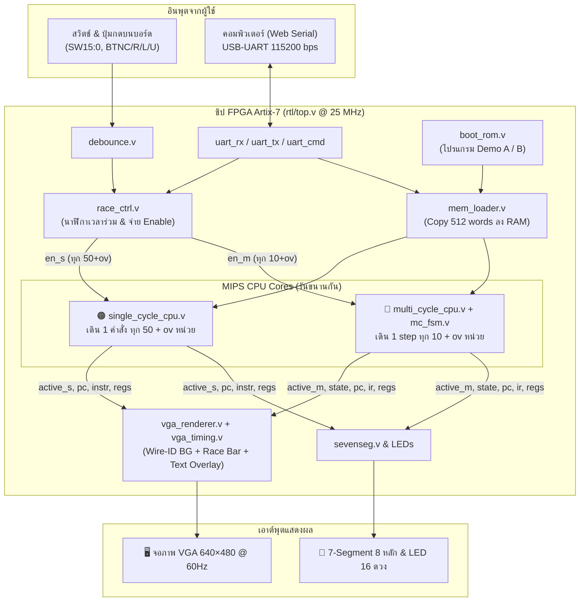
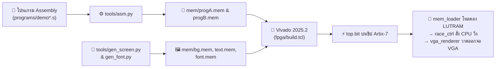
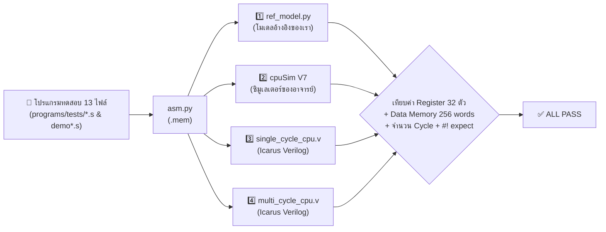

<div align="center">

# 🏁 CPU Race: Single-cycle vs Multicycle MIPS บน FPGA

**วงจร CPU MIPS สองสถาปัตยกรรมในชิป FPGA เดียวกัน รันโปรแกรมเดียวกัน แข่งกันตามเวลาจริง พร้อมแสดงผล Datapath แบบสดผ่านจอ VGA 640×480**

[-orange?style=for-the-badge&logo=amd)](https://digilent.com/reference/programmable-logic/nexys-a7/start)
[](cpu-race/rtl/)
[](cpu-race/sim/)
[](cpu-race/fpga/)
[-brightgreen?style=for-the-badge)](cpu-race/sim/run_all.py)

[**🚀 ลองใช้เลย**](#-ลองใช้เลย) · [**📊 ผลการแข่ง**](#-ผลการแข่ง) · [**🏗️ ภาพรวมระบบ**](#️-ภาพรวมระบบ) · [**⚙️ ฮาร์ดแวร์ (RTL)**](#️-ฮาร์ดแวร์-แต่ละส่วนทำอะไร) · [**🌐 เว็บจำลอง**](#-เว็บจำลองและเว็บเชื่อมต่อบอร์ด) · [**📚 เอกสารทั้งหมด**](#-เอกสารเพิ่มเติม)

---


*ภาพจากวงจรจริงที่ได้จากการจำลอง `rtl/top.v` ทั้งระบบด้วย `python sim/vga_frame.py` — ฝั่งซ้ายคือ **Single-cycle (สีส้ม)** และฝั่งขวาคือ **Multicycle (สีฟ้า)** เส้นที่ติดสีคือเส้นทางที่ข้อมูลกำลังวิ่งผ่านในจังหวะนั้น*

</div>

---

## 💡 คำถามที่โปรเจคนี้ตอบ

> **“CPU ตัวที่ 1 ใช้ 1 clock ต่อคำสั่งทุกคำสั่ง ส่วนตัวที่ 2 ต้องใช้ 3–5 clock ต่อคำสั่ง — ตัวไหนทำงานเสร็จเร็วกว่า?”**

คำตอบคือ **“ขึ้นอยู่กับโปรแกรมและค่า Overhead ของ Register”** เพราะเวลาทำงานจริงคำนวณจากสมการพื้นฐานของสถาปัตยกรรมคอมพิวเตอร์:

$$\text{Execution Time} = \text{IC} \times \text{CPI} \times T_{\text{clock}}$$

- 🟠 **Single-cycle (`CPI = 1`):** ทำเสร็จใน 1 clock แต่ความยาว clock ($T$) ต้องยาวเท่ากับคำสั่งที่ช้าที่สุด (`lw`) ทำให้คำสั่งสั้นๆ อย่าง `beq` หรือ `add` ต้องรอเวลาที่เหลือไปฟรีๆ
- 🔵 **Multicycle (`CPI = 3–5`):** ใช้จำนวน clock มากกว่า แต่ซอยจังหวะให้สั้นลง คำสั่งสั้นจึงจบได้เร็วกว่า **แต่ต้องแลกกับการเสียเวลาผ่าน Register คั่นกลาง (`ov`) ในทุกๆ step** หากค่า `ov` สูงเกินจุดตัด ผลการแข่งจะพลิกกลับทันที!

> [!NOTE]
> โปรเจคนี้จัดทำขึ้นในรายวิชา **Computer Architecture** · ภาควิชาวิศวกรรมคอมพิวเตอร์ คณะวิศวกรรมศาสตร์ มหาวิทยาลัยขอนแก่น (**กลุ่ม 19**)

---

## 📑 สารบัญ

- [🚀 ลองใช้เลย](#-ลองใช้เลย)
- [📊 ผลการแข่ง (Performance Paradox)](#-ผลการแข่ง)
- [🛠️ เครื่องมือและเทคโนโลยีที่ใช้](#️-ใช้อะไรสร้าง)
- [🏗️ ภาพรวมระบบและโมเดลเวลา](#️-ภาพรวมระบบ)
- [⚙️ ฮาร์ดแวร์: แต่ละส่วนทำอะไร (`rtl/`)](#️-ฮาร์ดแวร์-แต่ละส่วนทำอะไร)
- [🐍 เครื่องมือ Python (`tools/`)](#-เครื่องมือ-python)
- [🔄 ข้อมูลไหลจากโปรแกรมถึงจอได้อย่างไร](#-ข้อมูลไหลจากโปรแกรมถึงจอยังไง)
- [🧪 การทดสอบและตรวจสอบความถูกต้อง 4 ทาง](#-การทดสอบ)
- [🔌 การสังเคราะห์วงจรและลงบอร์ดจริง](#-ลงบอร์ดจริง)
- [🌐 เว็บจำลองและเว็บเชื่อมต่อบอร์ด](#-เว็บจำลองและเว็บเชื่อมต่อบอร์ด)
- [📂 โครงสร้างโฟลเดอร์](#-โครงสร้างโฟลเดอร์)
- [🧱 ลำดับการพัฒนาและปัญหาที่พบ](#-สร้างขึ้นมายังไง)
- [📌 สถานะและข้อจำกัด](#-สถานะและข้อจำกัด)
- [📚 เอกสารเพิ่มเติม](#-เอกสารเพิ่มเติม)
- [👥 ผู้จัดทำ (กลุ่ม 19)](#-ผู้จัดทำ)

---

## 🚀 ลองใช้เลย

### 1. ทดลองผ่านเบราว์เซอร์ทันที (ไม่ต้องติดตั้งอะไรเลย)

ดับเบิลคลิกไฟล์ [`cpu-race/web/index.html`](cpu-race/web/index.html) (เปิดด้วย Chrome หรือ Edge) ใช้งานได้แบบ Offline ทันทีโดยไม่ต้องต่ออินเทอร์เน็ตและไม่ต้องมีบอร์ด FPGA จะเห็น Single-cycle vs Multicycle แข่งกันทีละ step ด้วยภาพ Datapath เดียวกับจอ VGA

### 2. จำลองวงจรในคอมพิวเตอร์ (ไม่ต้องมีบอร์ด)

ต้องมี **Python 3** (พร้อมไลบรารี `Pillow`) และ [**Icarus Verilog 12**](https://bleyer.org/icarus/) อยู่ใน `PATH` (หรือติดตั้งไว้ที่ `C:\iverilog`)

```bash
cd cpu-race

# 1. รันชุดทดสอบทั้งหมด (Unit test + เทียบผล 4 ทาง + จำลองบอร์ด + ทดสอบเว็บ/UART)
python sim/run_all.py

# 2. จำลองวงจรทั้งบอร์ดแล้วจับภาพหน้าจอ VGA ออกมาเป็นไฟล์ PNG ใน build/frames/
python sim/vga_frame.py --prog B --ov 4

# 3. ดูการทำงานของโปรแกรมทีละ step (พร้อมสร้างไฟล์ .vcd สำหรับเปิดใน GTKWave)
python sim/trace.py programs/examples/ex_lw_add.s

# 4. คำนวณตารางเวลาแข่งและจุดพลิกผลของทุกค่า ov (0–15)
python tools/race_calc.py programs/demoA_alu_heavy.s
```

### 3. โหลดลงบอร์ดจริง (Digilent Nexys A7-100T)

ต้องมีโปรแกรม **Xilinx Vivado 2025.2** (รุ่น ML Standard ฟรี)

```bat
cd cpu-race

:: ทดสอบบอร์ดเบื้องต้น (สวิตช์ → LED, 7-Segment นับเลข)
fpga\run.bat smoke program

:: สังเคราะห์วงจรตัวเต็มและโปรแกรมลงบอร์ด แล้วต่อสาย VGA เข้าจอภาพ
fpga\run.bat top program
```

> [!TIP]
> ดูคู่มือการกดปุ่ม ตั้งสวิตช์ และลำดับการสาธิตบนบอร์ดอย่างละเอียดได้ที่ [`cpu-race/docs/demo_script.md`](cpu-race/docs/demo_script.md)

---

## 📊 ผลการแข่ง

ภายในบอร์ดมีโปรแกรม Demo 2 ตัวฝังอยู่ใน `boot_rom` (เลือกด้วยสวิตช์ `SW4`) และสามารถปรับค่า **`ov`** (Register Overhead `0–15` หน่วยเวลา) ได้สดๆ ด้วยสวิตช์ `SW3–0`:

| รายการเปรียบเทียบ | โปรแกรม A (`demoA_alu_heavy.s`) | โปรแกรม B (`demoB_mem_heavy.s`) |
|---|---|---|
| **โจทย์การทำงาน** | บวกเลข $1 + 2 + \dots + 10 = 55$ | รวมค่า Array 8 ตัวด้วย `lw` $= 31$ |
| **จำนวนคำสั่งทั้งหมด (IC)** | 56 คำสั่ง | 37 คำสั่ง |
| **จำนวน step ของ Multicycle** | 203 step | 147 step |
| **CPI เฉลี่ยของ Multicycle** | **3.63** (มี `beq`/`j` ที่ใช้ 3 step เยอะ) | **3.97** (มี `lw` ที่ใช้ 5 step เยอะ) |
| **Multicycle ชนะเมื่อ** | `ov ≤ 5` (พลิกที่ `ov = 6`) | `ov ≤ 3` (พลิกที่ `ov = 4`) |
| **เวลาจบที่ `ov = 0`** | 🟠 Single `2800` vs 🔵 **Multi `2030`** 🏆 | 🟠 Single `1850` vs 🔵 **Multi `1470`** 🏆 |
| **เวลาจบที่ `ov = 4`** | 🟠 Single `3024` vs 🔵 **Multi `2842`** 🏆 | 🟠 **Single `1998`** 🏆 vs 🔵 Multi `2058` |
| **เวลาจบที่ `ov = 6`** | 🟠 **Single `3136`** 🏆 vs 🔵 Multi `3248` | 🟠 **Single `2072`** 🏆 vs 🔵 Multi `2352` |

> [!IMPORTANT]
> **ไฮไลต์สำคัญที่ `ov = 4`:** แม้ตั้งค่า `ov = 4` เท่ากันเป๊ะ แต่ **โปรแกรม A ให้ Multicycle ชนะ** ในขณะที่ **โปรแกรม B ให้ Single-cycle ชนะ** เพราะคำสั่ง `lw` ต้องใช้ถึง 5 step ใน Multicycle ทำให้โปรแกรมที่เข้าถึงหน่วยความจำบ่อยมี CPI เฉลี่ยสูงและแพ้ภัย Overhead เร็วกว่า

*ตัวเลขทั้งหมดคำนวณจาก [`tools/race_calc.py`](cpu-race/tools/race_calc.py) และยืนยันตรงกัน 100% กับการจำลองวงจรจริงใน [`sim/run_all.py`](cpu-race/sim/run_all.py)*

---

## 🛠️ ใช้อะไรสร้าง

| ส่วนงาน | ภาษา / เครื่องมือที่ใช้ |
|---|---|
| **วงจรดิจิทัล (CPU, VGA, I/O, UART)** | **Verilog-2001** ([`cpu-race/rtl/`](cpu-race/rtl/)) |
| **จำลองวงจรและดู Waveform** | **Icarus Verilog 12** + **GTKWave** |
| **Assembler, Reference Model, สร้างภาพจอ, รันเทสต์** | **Python 3** ([`cpu-race/tools/`](cpu-race/tools/), [`cpu-race/sim/`](cpu-race/sim/)) |
| **สังเคราะห์วงจรและสร้าง Bitstream** | **Vivado 2025.2** สั่งงานด้วยสคริปต์ **Tcl** แบบ Non-project mode ([`cpu-race/fpga/`](cpu-race/fpga/)) |
| **เว็บจำลองและเว็บควบคุมบอร์ดสด** | **HTML5 + Vanilla JavaScript + Web Serial API** ([`web/`](cpu-race/web/), [`web-live/`](cpu-race/web-live/)) |
| **บอร์ดพัฒนา FPGA** | **Digilent Nexys A7-100T** (ชิป Xilinx Artix-7 `XC7A100T-1CSG324C`, Clock 100 MHz) |
| **ตัวตรวจคำตอบอ้างอิง (Golden Model)** | **cpuSim V7** ของอาจารย์และพี่ TA ([`tools/third_party/cpusim_v7/`](cpu-race/tools/third_party/cpusim_v7/)) |

---

## 🏗️ ภาพรวมระบบ



- **Clock Domain เดียวทั้งระบบ (25 MHz):** สร้างจาก 100 MHz ด้วย `MMCME2_BASE` ใน [`clk_gen.v`](cpu-race/rtl/clk_gen.v) จึงไม่มีปัญหาเรื่องการข้าม Clock Domain (CDC)
- **เดินด้วยสัญญาณ Enable:** CPU ทั้งสองไม่ได้เดินทุกจังหวะ 25 MHz แต่จะก้าวเดินเฉพาะเมื่อได้รับสัญญาณ `en_s` หรือ `en_m` จากตัวควบคุมการแข่ง ([`race_ctrl.v`](cpu-race/rtl/race/race_ctrl.v))

### ⏱️ โมเดลเวลา (หัวใจของการแข่ง)

เนื่องจากบนบอร์ดจริง CPU ทั้งสองตัวใช้สัญญาณนาฬิกาหลักตัวเดียวกัน หากปล่อยให้เดินทุก clock พร้อมกันจะไม่เห็นความแตกต่างของความยาว clock วงจร [`race_ctrl.v`](cpu-race/rtl/race/race_ctrl.v) จึงจำลอง **"หน่วยเวลาจริง"** แยกออกมา:

| สถาปัตยกรรม | เวลาที่ใช้ต่อการก้าว 1 ครั้ง | เหตุผลทางฮาร์ดแวร์ |
|---|---|---|
| 🟠 **Single-cycle** | 1 คำสั่ง = **`50 + ov`** หน่วย | Clock ต้องยาวพอสำหรับคำสั่งที่ช้าที่สุด (`lw`: `IMEM → REG → ALU → DMEM → REG` = 5 ช่วง × 10) และเสียเวลาผ่าน Register ปลายทางเพียง **ครั้งเดียว** |
| 🔵 **Multicycle** | 1 step = **`10 + ov`** หน่วย | แบ่งการทำงานเป็น step สั้นๆ ช่วงละ 10 หน่วย แต่ต้องเสียเวลาบันทึกค่าลง Register คั่นกลาง (`IR`, `MDR`, `A`, `B`, `ALUOut`) **ทุกๆ step** |

- **`ov` (Register Overhead `0–15`):** แทนเวลาที่สูญเสียทุกครั้งที่สัญญาณต้องล็อกเข้า Flip-Flop ในโลกจริง ได้แก่ *Setup time*, *Clock-to-Q delay* และ *Clock skew*
- **Step Mode (`SW15 = 0`):** กดปุ่ม `BTNC` 1 ครั้ง เวลาร่วมจะกระโดดไปยังเหตุการณ์ถัดไปทันที (`min(next_s, next_m)`)
- **Run Mode (`SW15 = 1`):** เวลาเดินเองอัตโนมัติตามความเร็วที่ตั้งด้วย `SW14–12` ใครถึงคำสั่ง `halt` ก่อนจะขึ้นคำว่า **`WINNER`** บนจอ

---

## ⚙️ ฮาร์ดแวร์: แต่ละส่วนทำอะไร

โค้ดวงจรทั้งหมดอยู่ในโฟลเดอร์ [`cpu-race/rtl/`](cpu-race/rtl/) เขียนด้วย **Verilog-2001** ล้วนโดยไม่พึ่งพา Soft-CPU สำเร็จรูป

### 1. ชุดคำสั่ง (ISA) และแผนผังหน่วยความจำ (Memory Map)

รองรับคำสั่ง MIPS 32-bit จำนวน **10 คำสั่ง** (ตามสไลด์ `w04c` และเพิ่ม `addi`):
- **R-type (คำนวณ):** `add`, `sub`, `and`, `or`, `slt`
- **I-type (คำนวณค่าคงที่ / หน่วยความจำ / เงื่อนไข):** `addi`, `lw`, `sw`, `beq`
- **J-type (กระโดด):** `j` (และจบโปรแกรมเมื่อเจอ `halt: j halt` ซึ่งกระโดดหาตัวเอง)

| ช่วง Address (Byte) | Word Index | การใช้งาน | Single-cycle | Multicycle |
|---|---|---|---|---|
| `0x0000 – 0x03FF` | `0 – 255` | **ส่วนโปรแกรม (`.text` 256 words)** | `IMEM` (แยกก้อน) | Unified Memory ครึ่งล่าง |
| `0x0400 – 0x07FF` | `256 – 511` | **ส่วนข้อมูล (`.data` 256 words)** | `DMEM` (แยกก้อน) | Unified Memory ครึ่งบน |

### 2. โมดูลย่อยใน `rtl/`

| โฟลเดอร์ / ไฟล์ | หน้าที่หลัก |
|---|---|
| [`rtl/common/alu.v`](cpu-race/rtl/common/alu.v) | คำนวณ บวก, ลบ, AND, OR, SLT (เทียบแบบ Signed) และส่งสัญญาณ `zero` สำหรับ `beq` |
| [`rtl/common/alu_control.v`](cpu-race/rtl/common/alu_control.v) | แปลงรหัส `ALUOp` + `funct` เป็นรหัสควบคุม ALU 4-bit ตามตารางในสไลด์ `w04a` |
| [`rtl/common/regfile.v`](cpu-race/rtl/common/regfile.v) | Register 32 ตัว (`$0` เป็น 0 เสมอ) อ่าน 2 พอร์ต เขียน 1 พอร์ต พร้อม **Debug Port พิเศษ** ให้จอ VGA ดึงค่า `$t0–$t7` ไปแสดงสด |
| [`rtl/common/sign_ext.v`](cpu-race/rtl/common/sign_ext.v) | ขยายเลข Immediate 16-bit เป็น 32-bit แบบรักษาเครื่องหมาย (Sign-extension) |
| [`rtl/single/single_cycle_cpu.v`](cpu-race/rtl/single/single_cycle_cpu.v)<br/>[`rtl/single/sc_control.v`](cpu-race/rtl/single/sc_control.v) | **Single-cycle CPU** ตามสไลด์ `w04a`: มี `IMEM` และ `DMEM` แยกกัน, Adder สำหรับ `PC+4` และ Branch แยกกัน ทำงานจบ **1 คำสั่งต่อ 1 enable (`CPI = 1`)** |
| [`rtl/multi/multi_cycle_cpu.v`](cpu-race/rtl/multi/multi_cycle_cpu.v)<br/>[`rtl/multi/mc_fsm.v`](cpu-race/rtl/multi/mc_fsm.v) | **Multicycle CPU** ตามสไลด์ `w04c`: ใช้ Memory ก้อนเดียวและ ALU ตัวเดียวสลับกัน มี Register คั่น (`IR`, `MDR`, `A`, `B`, `ALUOut`) ควบคุมด้วย **FSM 12 states** (`lw` = 5 step, R-type/`sw`/`addi` = 4 step, `beq`/`j` = 3 step) |
| [`rtl/mem/lutram.v`](cpu-race/rtl/mem/lutram.v)<br/>[`rtl/mem/boot_rom.v`](cpu-race/rtl/mem/boot_rom.v)<br/>[`rtl/mem/mem_loader.v`](cpu-race/rtl/mem/mem_loader.v) | **ระบบหน่วยความจำ:** ใช้ Distributed LUTRAM ที่อ่านค่าได้ทันที (Async Read) เพื่อให้ Single-cycle อ่านคำสั่งและข้อมูลทันใน 1 clock ส่วน `boot_rom` เก็บโปรแกรม Demo A/B ใน BRAM แล้วใช้ `mem_loader` คัดลอกลง CPU ทั้งสองตัวตอนกดรีเซ็ต |
| [`rtl/race/race_ctrl.v`](cpu-race/rtl/race/race_ctrl.v) | **ตัวคุมการแข่ง:** นับเวลาร่วม ปล่อยสัญญาณ `en_s` / `en_m` ตามโมเดลเวลา และล็อกเวลาที่แต่ละตัวทำเสร็จ |
| [`rtl/io/`](cpu-race/rtl/io/) | [`debounce.v`](cpu-race/rtl/io/debounce.v) กันปุ่มเด้ง, [`sevenseg.v`](cpu-race/rtl/io/sevenseg.v) สแกนไฟ 7-Segment 8 หลัก, และ [`uart_rx.v`](cpu-race/rtl/io/uart_rx.v) / [`uart_tx.v`](cpu-race/rtl/io/uart_tx.v) / [`uart_cmd.v`](cpu-race/rtl/io/uart_cmd.v) สำหรับเชื่อมต่อกับเว็บผ่านสาย USB |
| [`rtl/vga/vga_timing.v`](cpu-race/rtl/vga/vga_timing.v)<br/>[`rtl/vga/vga_renderer.v`](cpu-race/rtl/vga/vga_renderer.v) | **ระบบแสดงผล VGA 640×480 @ 60Hz** วาดภาพซ้อนกัน 3 ชั้นแบบ Real-time (ดูรายละเอียดด้านล่าง) |
| [`rtl/top.v`](cpu-race/rtl/top.v) | โมดูลระดับบนสุดที่รวมทุกชิ้นส่วนเข้าด้วยกันและผูกกับขาพอร์ตบนบอร์ดตามไฟล์ [`constr/nexys_a7_100t.xdc`](cpu-race/constr/nexys_a7_100t.xdc) |

### 🎨 เทคนิควาดจอ VGA 3 ชั้นแบบ Wire-ID

แทนที่จะเขียนวงจรลอจิกซับซ้อนเพื่อวาดเส้นและกล่องทีละพิกเซล [`vga_renderer.v`](cpu-race/rtl/vga/vga_renderer.v) แบ่งการแสดงผลออกเป็น 3 ชั้น:

1. **ชั้นที่ 1 — ภาพ Datapath แบบ Wire-ID (`bg.mem`):** ภาพพื้นหลังไม่ได้เก็บค่าสี RGB แต่เก็บ **"รหัสประจำเส้น (Wire-ID)"** ขนาด 6-bit วงจรเพียงแค่อ่านรหัสของพิกเซลนั้นแล้วเช็กกับบิตสัญญาณ `active` จาก CPU ว่าเส้นนั้นกำลังทำงานอยู่หรือไม่ ถ้าทำงานก็ระบาย **สีส้ม (Single)** หรือ **สีฟ้า (Multi)** ถ้าไม่ทำงานก็ระบายสีเทาเข้ม (ดูตารางจับคู่บิตได้ที่ [`docs/wire_map.md`](cpu-race/docs/wire_map.md))
2. **ชั้นที่ 2 — แถบความคืบหน้า (Race Progress Bar):** วาดแถบสีส้มและสีฟ้าเปรียบเทียบเวลาที่ใช้ไปของแต่ละฝั่ง
3. **ชั้นที่ 3 — ตัวอักษร 80×30 ช่อง (`text.mem` + `font.mem`):** แสดงค่าสดจากฮาร์ดแวร์ทั้ง `PC`, `IR`, ชื่อคำสั่ง, ชื่อ State ของ FSM, จำนวนคำสั่งที่ทำเสร็จ (`RETIRED`), เวลารวม (`TIME`), ผลผู้ชนะ (`WINNER`) และค่า Register `$t0–$t7` เทียบกันสองฝั่ง

| ระหว่างวิ่งแข่งขัน (`vga_race.png`) | โหมดกดทีละจังหวะ (`vga_step.png`) |
|:---:|:---:|
|  |  |
| *Single-cycle กำลังรัน `slt` ส่วน Multicycle อยู่ในสถานะ `BRANCH` (`beq`)* | *กด Step ดู Multicycle เดินไปถึงขั้น `ADDI_WB` (เขียนผลกลับลง Register)* |

---

## 🐍 เครื่องมือ Python

สคริปต์ทั้งหมดอยู่ใน [`cpu-race/tools/`](cpu-race/tools/) ช่วยจัดการตั้งแต่งานแปลงโค้ด Assembly ไปจนถึงการสร้างข้อมูลกราฟิกฝังลงชิป:

| ไฟล์สคริปต์ | หน้าที่ |
|---|---|
| [`tools/asm.py`](cpu-race/tools/asm.py) | **Custom MIPS Assembler:** แปลงไฟล์ `.s` เป็น `.mem` (เลขฐานสิบหก 8 หลัก จำนวน 512 บรรทัด แยก `.text` กับ `.data`) |
| [`tools/ref_model.py`](cpu-race/tools/ref_model.py) | **Reference Simulator:** ตัวจำลองอ้างอิงใน Python ที่ทำงานตามสเปคฮาร์ดแวร์ทุกประการ ใช้เป็นเฉลยหลักในการตรวจคำตอบ |
| [`tools/cpusim_adapter.py`](cpu-race/tools/cpusim_adapter.py) | **cpuSim Adapter:** นำโปรแกรมไปรันบน **cpuSim V7 ของอาจารย์** โดยแปลงรูปแบบคำสั่ง เติมคำสั่ง `SUB`, `AND`, `OR`, `SLT` และครอบแก้บั๊กโดยไม่แก้ไขไฟล์ต้นฉบับของอาจารย์ |
| [`tools/gen_screen.py`](cpu-race/tools/gen_screen.py) | **Datapath Screen Generator:** วาดภาพ Datapath ทั้งสองฝั่งด้วยโค้ด กำหนดเลข Wire-ID ให้แต่ละเส้น แล้วส่งออกเป็น `bg.mem` และ `text.mem` |
| [`tools/gen_font.py`](cpu-race/tools/gen_font.py) | **Font Generator:** สร้างฟอนต์ขนาด 8×16 พิกเซล ส่งออกเป็น `font.mem` |
| [`tools/build_mems.py`](cpu-race/tools/build_mems.py) | รันสร้างไฟล์ `.mem` ทั้งหมดใน [`cpu-race/mem/`](cpu-race/mem/) (`progA.mem`, `progB.mem`, `bg.mem`, `text.mem`, `font.mem`) สำหรับฝังลง Bitstream |
| [`tools/race_calc.py`](cpu-race/tools/race_calc.py) | คำนวณตารางเวลาจบของ Single-cycle และ Multicycle ในทุกค่า `ov` พร้อมระบุจุดตัดที่ผู้ชนะเปลี่ยน |
| [`tools/make_xdc.py`](cpu-race/tools/make_xdc.py) | สร้างไฟล์ขาพอร์ต (`smoke.xdc`, `nexys_a7_100t.xdc`) อัตโนมัติจากไฟล์ Master ของ Digilent เพื่อป้องกันการพิมพ์เลขขาผิด |
| [`tools/build_web.py`](cpu-race/tools/build_web.py) | ซิงค์โปรแกรม `.s` และพิกัดภาพ Datapath ชุดเดียวกับฮาร์ดแวร์ไปสร้างเป็นไฟล์ในโฟลเดอร์เว็บ |

---

## 🔄 ข้อมูลไหลจากโปรแกรมถึงจอยังไง



---

## 🧪 การทดสอบ

สามารถรันชุดทดสอบอัตโนมัติทั้งหมดได้บนคอมพิวเตอร์โดยไม่ต้องต่อบอร์ด ด้วยคำสั่งเดียว:

```bash
cd cpu-race
python sim/run_all.py
```

### ระบบตรวจสอบความถูกต้อง 4 ทาง (4-Way Lockstep Verification)



1. **Unit Tests (`tb_common`):** ทดสอบแยกชิ้นสำหรับ `alu`, `alu_control`, `regfile` และ `sign_ext`
2. **Instruction & Program Tests (เทียบ 4 ทาง):** รันโปรแกรมทดสอบทั้ง 13 โปรแกรมบน `ref_model.py`, `cpuSim V7`, `single_cycle_cpu.v` และ `multi_cycle_cpu.v` แล้วตรวจว่าค่า Register ทั้ง 32 ตัว, ข้อมูลใน Memory ทั้ง 256 words, จำนวน Cycle ที่ใช้ และค่าที่ระบุไว้ใน `#! expect` ตรงกันทั้งหมด
3. **Full-Board Race Simulation (`tb_top`):** จำลองวงจรระดับบนสุด `top.v` แข่งจริง 6 กรณี (`prog A` ที่ `ov = 0, 5, 6` และ `prog B` ที่ `ov = 3, 4, 15`) เวลาจบต้องตรงกับสูตรคำนวณทุกหน่วยเวลา
4. **Web Engine Verification (`test_web.js`):** ทดสอบตัวจำลอง `web/engine.js` เทียบกับผลของ Assembler, Reference Model และ RTL
5. **Full-Duplex UART Simulation (`test_uart.js`):** ใช้ `web-live/protocol.js` ตัวเดียวกับหน้าเว็บ ส่งคำสั่งคุยกับ `top.v` ผ่าน UART ใน Simulation ครบทั้ง 14 กรณี

```text
[PASS] tb_common (alu, alu_control, regfile, sign_ext)
[PASS] t_add ... demoB_mem_heavy        13 โปรแกรม: cpusim=ref single=ref multi=ref
[PASS] race prog A ov=0 / 5 / 6, prog B ov=3 / 4 / 15
[PASS] web/engine.js เทียบกับ asm/ref_model/RTL
[PASS] UART: เว็บ web-live/protocol.js คุยกับ top.v
ALL PASS
```

---

## 🔌 ลงบอร์ดจริง

สคริปต์ [`fpga/run.bat`](cpu-race/fpga/run.bat) เรียกใช้งาน Vivado แบบ Batch ด้วย [`fpga/build.tcl`](cpu-race/fpga/build.tcl) (Non-project mode ไม่สร้างไฟล์ `.xpr` รกโฟลเดอร์) โดยอ่านไฟล์จาก `rtl/`, `constr/` และ `mem/` แล้วทำ Synthesis → Place → Route → Bitstream จากนั้น [`fpga/program.tcl`](cpu-race/fpga/program.tcl) จะโหลดไฟล์ลงบอร์ดให้ทันที

### 📈 ผลการสังเคราะห์วงจรตัวเต็ม (`top`) บน Vivado 2025.2

| รายการวัดผล | ค่าที่ได้บนชิป `XC7A100T-1CSG324C` |
|---|---|
| **Errors / Critical Warnings** | `0` / `0` |
| **Timing Summary (@ 25 MHz)** | **WNS `+19.195 ns`**, **WHS `+0.134 ns`** (ผ่าน Timing สบายมาก) |
| **Slice LUTs** | `4,115` / `63,400` (**6.49%**) |
| **Slice Registers (Flip-Flops)** | `2,781` / `126,800` (**2.19%**) |
| **LUT as Memory (LUTRAM)** | `691` |
| **Block RAM Tile (BRAM)** | `44` / `135` (**32.59%** — ใช้เก็บภาพพื้นหลัง VGA และ Boot ROM) |
| **MMCM (`MMCME2_BASE`)** | `1` / `6` |

### 🎛️ คู่มือปุ่มกดและสวิตช์บนบอร์ด Nexys A7-100T

| ปุ่ม / สวิตช์ | หน้าที่การทำงาน |
|---|---|
| **`BTNC` (ปุ่มกลาง)** | **Step:** ก้าวเวลาไปยังเหตุการณ์ถัดไป 1 จังหวะ (ใช้เมื่อ `SW15 = 0`) |
| **`BTNR` (ปุ่มขวา)** | **Run / Pause:** เริ่มวิ่งแข่งขันหรือหยุดชั่วคราว (ใช้เมื่อ `SW15 = 1`) |
| **`BTNL` (ปุ่มซ้าย)** | **Reload / Reset:** โหลดโปรแกรมจาก Boot ROM ลง RAM ใหม่ และรีเซ็ตเวลาเป็น `0` |
| **`BTNU` (ปุ่มบน)** | **7-Seg Mode:** สลับการแสดงผลบน 7-Segment ระหว่าง *จำนวนคำสั่งที่ทำเสร็จ* กับ *เวลาที่ใช้* |
| **`CPU_RESETN` (ปุ่มแดง)** | รีเซ็ตทั้งระบบและโหลดโปรแกรมเริ่มต้นใหม่อัตโนมัติ |
| **`SW3–0`** | ตั้งค่า **`ov` (Register Overhead)** ตั้งแต่ `0000` (`0`) ถึง `1111` (`15`) |
| **`SW4`** | เลือกโปรแกรม Demo: **ลง (`0`) = โปรแกรม A (ALU heavy)**, **ขึ้น (`1`) = โปรแกรม B (Memory heavy)** |
| **`SW15`** | เลือกโหมด: **ลง (`0`) = Step Mode**, **ขึ้น (`1`) = Run Mode** |
| **`SW14–12`** | ปรับความเร็วขณะ Run Mode (`000` ช้าสุด → `111` เร็วสุด, แนะนำ **`011`** ใช้เวลาแข่ง ~15 วินาที) |

---

## 🌐 เว็บจำลองและเว็บเชื่อมต่อบอร์ด


| แอปพลิเคชันเว็บ | รายละเอียดและฟีเจอร์เด่น |
|---|---|
| 🖥️ **[`cpu-race/web/`](cpu-race/web/)**<br/>**CPU Race Lab** *(Offline)* | เปิดไฟล์ [`web/index.html`](cpu-race/web/index.html) ใช้งานได้ทันทีโดยไม่ต้องมีบอร์ด มีตัวจำลอง CPU ใน JavaScript ([`engine.js`](cpu-race/web/engine.js)) ที่ตรวจสอบตรงกับ Verilog แล้ว ประกอบด้วย:<br/>• **หน้าแข่ง:** ภาพ Datapath เดียวกับจอ VGA ชี้เมาส์ดูชื่อสายไฟและค่าในเส้นได้ พร้อมกราฟจุดตัดทุกค่า `ov`<br/>• **บทเรียน 3 ระดับ:** อธิบายตั้งแต่ระดับเริ่มต้น ภาษาห้องเรียน ไปจนถึงระดับโค้ด Verilog<br/>• **Assembler & เขียนโปรแกรมเอง:** พิมพ์โค้ด MIPS ดูการแยกบิตสีของ Machine Code และส่งไปวิ่งแข่งได้ทันที<br/>• **เลขฐาน & แบบฝึกหัดสุ่ม:** เครื่องมือแปลงเลขฐาน/ถอดรหัสคำสั่ง และโจทย์แบบฝึกหัดสุ่มพร้อมเฉลย<br/>• **คู่มือตั้งสวิตช์บนบอร์ด:** จำลองการโยกสวิตช์บนบอร์ดพร้อมบอกค่าที่ควรเห็นบนหน้าจอจริง |
| 🔌 **[`cpu-race/web-live/`](cpu-race/web-live/)**<br/>**CPU Race Live** *(Web Serial)* | เชื่อมต่อกับบอร์ด Nexys A7-100T จริงผ่านสาย USB ด้วย **Web Serial API** (บน Chrome / Edge หรือรันผ่าน [`live.bat`](cpu-race/live.bat)) เพื่อสั่ง Step / Run / ตั้งค่า `ov` / อัปโหลดโค้ด Assembly ที่เขียนเองลงไปรันบน FPGA สดๆ พร้อมระบบตรวจคำตอบเทียบระหว่างบอร์ดจริงกับตัวจำลองโดยอัตโนมัติ (ดูโปรโตคอลใน [`docs/protocol.md`](cpu-race/docs/protocol.md)) |

---

## 📂 โครงสร้างโฟลเดอร์

```text
Project/
├── README.md                        # เอกสารภาพรวมโปรเจคฉบับสมบูรณ์ (ไฟล์นี้)
└── cpu-race/
    ├── README.md                    # คู่มือเริ่มต้นเร็ว (Quick Start)
    ├── live.bat                     # สคริปต์เปิด local server สำหรับใช้งาน CPU Race Live
    ├── rtl/                         # วงจรฮาร์ดแวร์ Verilog-2001 ที่สังเคราะห์ลงชิป FPGA
    │   ├── common/                  #   ALU, ALU Control, Register File (32×32), Sign-Extend
    │   ├── single/                  #   Single-cycle MIPS CPU + Main Control
    │   ├── multi/                   #   Multicycle MIPS CPU + 12-State FSM Control
    │   ├── mem/                     #   LUTRAM (Async read), Boot ROM, Memory Loader
    │   ├── race/                    #   Race Controller (นาฬิกาเวลาร่วม & จ่ายสัญญาณ Enable)
    │   ├── io/                      #   Button Debouncer, 7-Segment Scanner, UART RX/TX/Command
    │   ├── vga/                     #   VGA Timing (640×480@60Hz) & 3-Layer Wire-ID Renderer
    │   ├── clk_gen.v                #   MMCM แปลงสัญญาณนาฬิกา 100 MHz → 25 MHz
    │   ├── top.v                    #   โมดูลหลักรวมทุกระบบเข้าด้วยกัน
    │   └── top_smoke.v              #   วงจรทดสอบบอร์ดเบื้องต้น (Smoke Test)
    ├── programs/                    # โปรแกรมภาษา MIPS Assembly (.s)
    │   ├── demoA_alu_heavy.s        #   โปรแกรมแข่ง A: บวกเลข 1..10 (ALU & Branch เยอะ)
    │   ├── demoB_mem_heavy.s        #   โปรแกรมแข่ง B: รวมค่า Array 8 ตัว (Memory lw เยอะ)
    │   ├── examples/                #   ตัวอย่างโปรแกรมประกอบบทเรียน
    │   └── tests/                   #   ชุดทดสอบระดับคำสั่ง (Unit/Instruction Tests 10 ไฟล์)
    ├── tools/                       # เครื่องมือ Python (Assembler, Reference Model, สร้างภาพจอ)
    │   └── third_party/cpusim_v7/   #   ซิมูเลเตอร์ cpuSim V7 ของอาจารย์และพี่ TA (ต้นฉบับไม่แก้ไข)
    ├── sim/                         # Testbenches (Verilog) และสคริปต์รันทดสอบอัตโนมัติ
    ├── mem/                         # ไฟล์ข้อมูลหน่วยความจำ (.mem) ที่ฝังลงใน Bitstream
    ├── constr/                      # ไฟล์กำหนดขาพอร์ต (.xdc) สำหรับบอร์ด Nexys A7-100T
    ├── fpga/                        # สคริปต์ Vivado Tcl (build.tcl, program.tcl, run.bat)
    ├── web/                         # เว็บแอปพลิเคชัน CPU Race Lab (ใช้งานแบบ Offline)
    ├── web-live/                    # เว็บแอปพลิเคชัน CPU Race Live (คุยกับบอร์ดผ่าน USB-UART)
    └── docs/                        # เอกสารประกอบทั้งหมด (บทเรียน, คู่มือ, สเปค, สคริปต์เดโม่)
```

---

## 🧱 สร้างขึ้นมายังไง

โปรเจคนี้พัฒนาแบบ **Bottom-up** โดยสร้างและทดสอบความถูกต้องทีละชั้นก่อนประกอบเข้าด้วยกัน:

1. **ล็อกสเปคและสถาปัตยกรรม ([`docs/spec.md`](cpu-race/docs/spec.md)):** กำหนดชุดคำสั่ง 10 ตัว, Memory Map, ตารางสัญญาณ Control และสมการโมเดลเวลา
2. **สร้างเครื่องมือพื้นฐาน:** เขียน Assembler ([`asm.py`](cpu-race/tools/asm.py)), ตัวจำลองอ้างอิง ([`ref_model.py`](cpu-race/tools/ref_model.py)) และชุดโปรแกรมทดสอบครบทุกคำสั่ง
3. **สร้างชิ้นส่วนกลาง (`rtl/common/`):** พัฒนา ALU, ALU Control, Register File และทดสอบแยกชิ้นด้วย `tb_common.v`
4. **พัฒนา Single-cycle CPU (`rtl/single/`):** ต่อ Datapath ตามสไลด์ `w04a` แล้วรันเทียบผลลัพธ์กับ `ref_model.py`
5. **พัฒนา Multicycle CPU (`rtl/multi/`):** ออกแบบ FSM 12 States และ Datapath ตามสไลด์ `w04c` แล้วตรวจทั้งค่า Register และจำนวน Step
6. **เชื่อมต่อ `cpuSim` ของอาจารย์:** เขียน [`cpusim_adapter.py`](cpu-race/tools/cpusim_adapter.py) เพื่อตรวจคำตอบเพิ่มเป็นทางที่ 4
7. **สร้างตัวคุมการแข่งและระบบโหลดโปรแกรม:** พัฒนา `race_ctrl.v`, `boot_rom.v`, `mem_loader.v` และส่วนติดต่อปุ่มกด/ไฟ 7-Segment
8. **ออกแบบระบบแสดงผล VGA แบบ Wire-ID:** เขียนสคริปต์วาดภาพ Datapath เป็นรหัสเส้น (`gen_screen.py`) แล้วสร้าง `vga_renderer.v` พร้อมตรวจสอบภาพที่ได้จาก Simulation ด้วย `vga_frame.py`
9. **รวมระบบใน `top.v` และลงบอร์ดจริง:** สังเคราะห์วงจรด้วย Vivado 2025.2 และทดสอบรันจริงบนบอร์ด Nexys A7-100T
10. **พัฒนาเว็บจำลอง (`web/`) และระบบเชื่อมต่อบอร์ดสด (`web-live/` + UART):** ขยายผลสู่เครื่องมือสื่อการสอนแบบ Interactive

> [!WARNING]
> **ปัญหาทางเทคนิคที่พบและวิธีแก้ไขระหว่างพัฒนา:**
> - **รหัส `funct` ของคำสั่ง `slt` ในสไลด์:** ในสไลด์ `w04c` หน้า 2 พิมพ์ค่า `funct` ของ `slt` เป็น `0xA` แต่ค่ามาตรฐาน MIPS จริงคือ **`0x2A`** (ยืนยันตรงกับสไลด์ `w04a` หน้า 25 และ `isa.py` ใน `cpuSim` ของอาจารย์)
> - **ข้อจำกัดของ `cpuSim V7`:** ตัวจำลองต้นฉบับยังไม่มีคำสั่ง `SUB`, `AND`, `OR`, `SLT` และมีบั๊กการอ้างอิง Index ในคำสั่ง `ADD` จึงสร้าง [`cpusim_adapter.py`](cpu-race/tools/cpusim_adapter.py) ครอบจากภายนอกโดยไม่แตะต้องไฟล์ต้นฉบับของอาจารย์
> - **ความล่าช้าของ Block RAM (BRAM):** BRAM ใน FPGA ต้องใช้เวลาอ่าน 1 ขอบนาฬิกา (Synchronous Read) ทำให้ Single-cycle CPU ไม่สามารถอ่านคำสั่งและข้อมูลให้เสร็จภายใน 1 clock ได้ จึงเปลี่ยนไปใช้ **Distributed LUTRAM** ([`lutram.v`](cpu-race/rtl/mem/lutram.v)) ที่อ่านค่าได้ทันทีแบบ Asynchronous ส่วน BRAM นำไปใช้เก็บภาพพื้นหลัง VGA และฟอนต์แทน

---

## 📌 สถานะและข้อจำกัด

- ✅ **Simulation & Verification:** ผ่านการทดสอบครบทุกส่วน 100% (`python sim/run_all.py` ได้ `ALL PASS`)
- ✅ **FPGA Hardware Build:** สังเคราะห์วงจรผ่านบน Vivado 2025.2 (0 Errors, WNS `+19.195 ns`) และทดสอบรันจริงบนบอร์ด Nexys A7-100T ออกจอ VGA สำเร็จแล้ว
- ✅ **Offline Web Lab (`web/`):** ใช้งานได้สมบูรณ์ทุกระบบและผ่านการตรวจสอบตรงกับ RTL
- ⏳ **UART Live Web (`web-live/`):** ผ่านการจำลองคุยกับ `top.v` ครบทุกคำสั่งแล้ว (รอโปรแกรม Bitstream รุ่นรวม UART ลงบอร์ดจริง)
- **ขอบเขตของ ISA:** ไม่ทำระบบ Overflow Exception (`add`/`sub`/`addi` ทำงานแบบไม่เกิด Trap), ไม่มีคำสั่ง `jal`, การเข้าถึงข้อมูลด้วย `lw`/`sw` ต้องอยู่ในช่วง Data Memory (`0x0400–0x07FF`) และยังไม่ได้ทำสถาปัตยกรรมแบบ Pipelining (ซึ่งสามารถนำไปพัฒนาต่อยอดได้)

---

## 📚 เอกสารเพิ่มเติม

เอกสารทุกฉบับเขียนอธิบายอย่างละเอียดอยู่ในโฟลเดอร์ [`cpu-race/docs/`](cpu-race/docs/):

| เอกสาร | เนื้อหาข้างในเหมาะสำหรับใคร |
|---|---|
| 🚀 [`cpu-race/README.md`](cpu-race/README.md) | **Quick Start:** สรุปคำสั่งรันจำลองวงจรและคำสั่งโหลดลงบอร์ดแบบสั้นกระชับ |
| 📖 [`docs/tutorial.md`](cpu-race/docs/tutorial.md) | **บทเรียนฉบับสมบูรณ์:** ปูพื้นฐานตั้งแต่ศูนย์ว่า CPU, Machine Code, Single-cycle และ Multicycle ทำงานอย่างไร (อธิบาย 3 ระดับ พร้อมแบบฝึกหัดและเฉลย) |
| 🛠️ [`docs/manual.md`](cpu-race/docs/manual.md) | **คู่มือการใช้งาน:** วิธีติดตั้งเครื่องมือ รันเทสต์ เขียนโค้ด Assembly ของตัวเอง เปิดดู Waveform ใน GTKWave และแก้ปัญหาที่พบบ่อย |
| 🎤 [`docs/demo_script.md`](cpu-race/docs/demo_script.md) | **สคริปต์สาธิตหน้าชั้นเรียน:** ลำดับการกดปุ่ม ตั้งสวิตช์บนบอร์ด ตารางตัวเลขเวลาจบทั้งเลขฐาน 10 และฐาน 16 พร้อมแนวคำถาม-คำตอบ |
| 📐 [`docs/spec.md`](cpu-race/docs/spec.md) | **เอกสารสเปคระบบ (Source of Truth):** รายละเอียดการออกแบบ ตาราง Control/FSM และการตัดสินใจทางวิศวกรรมทั้งหมด |
| 🎨 [`docs/wire_map.md`](cpu-race/docs/wire_map.md) | **ตาราง Wire-ID:** อธิบายว่าบิตไหนของสัญญาณ `active_s` และ `active_m` คู่กับเส้นไหนบนจอ VGA |
| 🔌 [`docs/protocol.md`](cpu-race/docs/protocol.md) | **โปรโตคอล UART:** รูปแบบคำสั่งและโครงสร้างแพ็กเก็ต 306 ไบต์ระหว่างเว็บ `CPU Race Live` กับบอร์ด FPGA |

---

## 👥 ผู้จัดทำ

**กลุ่ม 19** · รายวิชา Computer Architecture · ภาควิชาวิศวกรรมคอมพิวเตอร์ คณะวิศวกรรมศาสตร์ มหาวิทยาลัยขอนแก่น

| ลำดับ | ชื่อ-นามสกุล | รหัสนักศึกษา | ส่วนงานที่รับผิดชอบและนำเสนอ |
|:---:|---|---|---|
| 1 | **นายอธิปัตย์ นิลทะราช** | `673040134-8` | สถาปัตยกรรมระบบบนบอร์ด FPGA, ตัวคุมการแข่ง (`race_ctrl`), โมเดลเวลา และควบคุมฮาร์ดแวร์ |
| 2 | **นายพีรพัฒน์ บุญฤกษ์** | `673040694-6` | การจำลองการแข่งขัน, วิเคราะห์ผล Performance Paradox, เครื่องมือทดสอบ และสาธิตการทำงาน |
| 3 | **นายศิริราช กางทอง** | `673040131-4` | การออกแบบชุดคำสั่ง MIPS, Single-cycle Datapath & Control และ Multicycle FSM |
| 4 | **นายณภัทร ผดุงกิจ** | `673040384-5` | ภาพรวมโครงงาน, ระบบแสดงผล VGA Wire-ID Renderer, เว็บจำลอง และสื่อนำเสนอ |

---

## 🙏 อ้างอิงและกิตติกรรมประกาศ

- เอกสารคำสอนและสไลด์รายวิชา **Computer Architecture** (`w01b`, `w02a`, `w04a`, `w04c`) โดย **ผศ.ดร.ธัชพงศ์ กตัญญูกุล** ภาควิชาวิศวกรรมคอมพิวเตอร์ มหาวิทยาลัยขอนแก่น
- โปรแกรมจำลอง **cpuSim (รุ่น V7)** โดยอาจารย์และทีมผู้ช่วยสอน (TA) ซึ่งนำมาใช้เป็นตัวตรวจคำตอบอ้างอิงใน [`tools/third_party/cpusim_v7/`](cpu-race/tools/third_party/cpusim_v7/)
- ไฟล์กำหนดขาพอร์ตต้นฉบับ [`Nexys-A7-100T-Master.xdc`](https://github.com/Digilent/digilent-xdc) จาก **Digilent**
