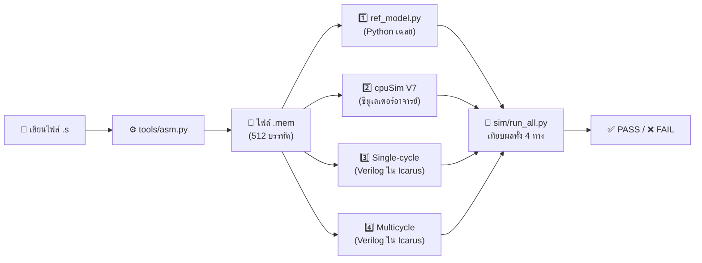

# 🛠️ คู่มือการใช้งาน CPU Race

> [!NOTE]
> คู่มือนี้อธิบาย **วิธีใช้งานเครื่องมือทั้งหมดในโปรเจค** ตั้งแต่การจำลองวงจร การเขียนโค้ด Assembly ไปจนถึงการโหลดลงบอร์ด FPGA
> - หากยังไม่คุ้นเคยว่า Single-cycle และ Multicycle ทำงานอย่างไร แนะนำให้อ่าน [`tutorial.md`](tutorial.md) ก่อน
> - ทุกคำสั่งในคู่มือนี้ให้รันจากโฟลเดอร์ `cpu-race/` (ใน VS Code สามารถกด `` Ctrl+` `` เพื่อเปิด Terminal ได้ทันที)

---

## 📑 สารบัญ

1. [ภาพรวม: ในโปรเจคมีอะไรบ้าง](#1-ภาพรวม-ในโปรเจคมีอะไรบ้าง)
2. [การติดตั้งเครื่องมือ (ทำครั้งเดียว)](#2-ติดตั้ง-ทำครั้งเดียว)
3. [การรันเทสต์ทั้งหมด (`run_all.py`)](#3-รันเทสต์ทั้งหมด)
4. [การดูโปรแกรมวิ่งทีละ Step (`trace.py` & GTKWave)](#4-ดูโปรแกรมวิ่งทีละ-step-trace)
5. [การเขียนโปรแกรม Assembly เอง](#5-เขียนโปรแกรม-assembly-เอง)
6. [การลงบอร์ดจริงและการใช้งานเว็บ (`web/` & `web-live/`)](#6-ลงบอร์ดและใช้งานเว็บ)
7. [การแก้ปัญหาที่พบบ่อย (Troubleshooting)](#7-แก้ปัญหาที่เจอบ่อย)
8. [สถานะของแต่ละส่วนในระบบ](#8-สถานะของแต่ละส่วน)

---

## 1. ภาพรวม: ในโปรเจคมีอะไรบ้าง

```text
cpu-race/
├── docs/        เอกสารประกอบ (สเปค, คู่มือ, บทเรียน, สคริปต์เดโม่, wire map, โปรโตคอล)
├── rtl/         วงจร CPU ที่เขียนด้วย Verilog-2001  ← ของจริงที่สังเคราะห์ลงบอร์ด
│   ├── common/    ชิ้นส่วนที่ใช้ร่วมกัน: ALU, ALU control, register file, sign-extend
│   ├── single/    Single-cycle CPU + Main Control
│   ├── multi/     Multicycle CPU + 12-State FSM
│   ├── mem/       หน่วยความจำ (LUTRAM), boot ROM, ตัวโหลดโปรแกรม
│   ├── race/      ตัวคุมการแข่ง (นาฬิกาเวลาร่วม)
│   ├── io/        ปุ่มกด (debounce), 7-segment, UART RX/TX/Command
│   ├── vga/       จอ VGA (timing + 3-layer renderer)
│   ├── clk_gen.v  แปลงสัญญาณนาฬิกา 100 MHz → 25 MHz
│   ├── top.v      รวมทุกโมดูลลงบอร์ด
│   └── top_smoke.v  วงจรทดสอบบอร์ดเบื้องต้น (สวิตช์ → LED, 7-seg นับเลข)
├── programs/    โปรแกรม MIPS Assembly ที่จะให้ CPU รัน
│   ├── tests/     เทสต์แยกทีละคำสั่ง (10 ไฟล์)
│   ├── examples/  ตัวอย่างประกอบบทเรียน
│   └── demo*.s    โปรแกรมที่ใช้แข่งขันตอนนำเสนอ (A และ B)
├── sim/         ตัวทดสอบ (testbench) และสคริปต์รันเทสต์อัตโนมัติ
├── tools/       เครื่องมือ Python: assembler, reference model, สร้างภาพจอ, สร้างไฟล์ขา
├── fpga/        สคริปต์ Vivado Tcl แบบ Non-project mode
├── constr/      ไฟล์ขาพอร์ต (.xdc) ของบอร์ด Nexys A7-100T
├── mem/         ไฟล์ข้อมูลที่ฝังลงชิป: โปรแกรม demo, ฟอนต์, ภาพพื้นหลัง, template ตัวหนังสือ
├── web/         เว็บ CPU Race Lab (ใช้งานแบบ Offline)
├── web-live/    เว็บ CPU Race Live (เชื่อมต่อบอร์ดผ่าน USB Web Serial)
└── build/       ไฟล์ชั่วคราวที่เครื่องมือสร้างขึ้น (ลบทิ้งได้ทุกเมื่อ)
```

### 🔄 ลำดับการไหลของงานตรวจสอบ (Verification Pipeline)



---

## 2. ติดตั้ง (ทำครั้งเดียว)

| โปรแกรม | ใช้ทำอะไร | วิธีติดตั้งบน Windows | คำสั่งตรวจสอบ |
|---|---|---|---|
| **Python 3** | รัน Assembler, Reference Model, สคริปต์เทสต์ | [python.org](https://www.python.org/) หรือ `winget install Python.Python.3.13` | `python --version` |
| **Icarus Verilog 12** | จำลองวงจร Verilog (Simulation) | `winget install Icarus.Verilog` | มีไฟล์ `C:\iverilog\bin\iverilog.exe` |
| **GTKWave** | เปิดดูคลื่นสัญญาณ (Waveform `.vcd`) | ติดตั้งมาพร้อมกับ Icarus Verilog ด้านบน | `C:\iverilog\gtkwave\bin\gtkwave.exe` |
| **VS Code** | แก้ไขโค้ดและเปิด Terminal | [code.visualstudio.com](https://code.visualstudio.com/) | – |
| **Vivado 2025.2** | สังเคราะห์ Bitstream และโหลดลงบอร์ดจริง | ใช้เฉพาะเมื่อต้องการ Build ลงบอร์ด FPGA | `vivado -version` |

> [!TIP]
> สคริปต์ Python ในโปรเจคนี้สามารถค้นหา `C:\iverilog\bin` ได้โดยอัตโนมัติ แม้ว่ายังไม่ได้เพิ่มโฟลเดอร์ดังกล่าวเข้าใน `PATH` ของ Windows ก็ตาม
> **ส่วนเสริม VS Code ที่แนะนำ:** `Verilog-HDL/SystemVerilog` (สำหรับไฮไลต์สีโค้ด Verilog) และ `Python`

---

## 3. รันเทสต์ทั้งหมด

```bash
python sim/run_all.py
```

ตัวอย่างผลลัพธ์:

```text
[PASS] tb_common (alu, alu_control, regfile, sign_ext)
[PASS] t_add              retired=7     mc_steps=28    expects=6   cpusim=ref single=ref multi=ref
[PASS] t_lw_sw            retired=12    mc_steps=53    expects=8   cpusim=ref single=ref multi=ref
...
------------------------------------------------------------
ALL PASS
```

### วิธีอ่านผลการทดสอบ

| ข้อความแสดงผล | ความหมาย |
|---|---|
| `tb_common` | ทดสอบชิ้นส่วนย่อยระดับโมดูล (`ALU` ทุกคำสั่ง, `Register File`, `ALU Control`, `Sign-Extend`) |
| `retired=7` | โปรแกรมนี้รันคำสั่งสำเร็จไป 7 คำสั่ง (ไม่นับคำสั่ง `halt` ตอนจบ) |
| `mc_steps=28` | Multicycle CPU ใช้เวลาทั้งหมด 28 step (clock) สำหรับโปรแกรมนี้ |
| `expects=6` | ตรวจสอบค่าที่เขียนคาดการณ์ไว้ในไฟล์ `.s` (`#! expect`) ผ่านครบ 6 ข้อ |
| `cpusim=ref` | ผลลัพธ์ตรงกับ `cpuSim V7` ของอาจารย์ครบทุก Register |
| `single=ref` | Single-cycle ให้ผล **ตรงกับเฉลย** ทุก Register, ทุก Word ใน Data Memory และใช้จำนวน Cycle ถูกต้อง |
| `multi=ref` | Multicycle ให้ผลตรงกับเฉลย และใช้จำนวน Step ตรงตามสเปค FSM |
| `single!=ref` | **ผลไม่ตรงกับเฉลย** โดยจะมีบรรทัดแจ้งว่า Register หรือ Memory ช่องใดต่างกัน เช่น `ref: r19 00000001  rtl: r19 00000000` (หมายถึง `$19` ควรเป็น `1` แต่ได้ `0`) |

**การรันทดสอบเฉพาะบางโปรแกรม:**

```bash
python sim/run_all.py t_slt t_beq
```

---

## 4. ดูโปรแกรมวิ่งทีละ step (trace)

เครื่องมือ [`sim/trace.py`](../sim/trace.py) ช่วยให้เห็นการทำงานภายใน CPU ทีละจังหวะ เหมาะสำหรับใช้ศึกษาการทำงานและไล่หาบั๊ก:

```bash
python sim/trace.py programs/examples/ex_lw_add.s --reg t2
```

| ตัวเลือก (Flag) | หน้าที่การทำงาน |
|---|---|
| `--core single` / `--core multi` | เลือกดูเฉพาะตัวเดียว (ค่าเริ่มต้นจะแสดงทั้งสองตัวต่อกัน) |
| `--reg t2` หรือ `--reg 10` | แสดงค่าของ Register ที่ระบุในทุกบรรทัด *(หมายเหตุ: ใน PowerShell อย่าพิมพ์ `$t2` ตรงๆ เพราะ `$` จะถูกตีความเป็นตัวแปรของ Shell)* |
| `--vcd` | สร้างไฟล์ Waveform (`.vcd`) เก็บไว้ใน `build/trace/` สำหรับเปิดดูด้วย GTKWave |

ตัวอย่างผลลัพธ์ของ Multicycle:

```text
cycle    0  S0  FETCH      pc=00000000  instr=00000000  retired=0  active=0180003f  $10=00000000
cycle    1  S1  DECODE     pc=00000004  instr=8c080400  retired=0  active=030003c8  $10=00000000
cycle    2  S2  MEM_ADDR   pc=00000004  instr=8c080400  retired=0  active=01001600  $10=00000000
cycle    3  S3  MEM_READ   pc=00000004  instr=8c080400  retired=0  active=00806002  $10=00000000
cycle    4  S4  MEM_WB     pc=00000004  instr=8c080400  retired=0  active=02018000  $10=00000000
cycle    5  S0  FETCH      pc=00000004  instr=8c080400  retired=1  ...
```

- แต่ละบรรทัดแสดงสถานะ **ก่อน** เดิน Step นั้นๆ
- ค่า `instr` ของ Multicycle คือค่าที่อยู่ในกล่อง `IR` (Instruction Register) ดังนั้นในจังหวะ `S0 FETCH` จึงยังแสดงคำสั่งเก่าอยู่ เพราะกำลังจะไปหยิบคำสั่งใหม่จาก Memory
- ค่า `active` คือบิตมาสก์ที่บอกว่าเส้นไหนในภาพ Datapath กำลังติดสี (ดูตารางความหมายได้ที่ [`wire_map.md`](wire_map.md))

### 📈 วิธีเปิดดู Waveform ด้วย GTKWave

1. รันสร้างไฟล์ `.vcd`:
   ```bash
   python sim/trace.py programs/examples/ex_lw_add.s --core multi --vcd
   ```
2. เปิดโปรแกรม GTKWave:
   ```bat
   C:\iverilog\gtkwave\bin\gtkwave.exe build\trace\ex_lw_add.multi.vcd
   ```
3. ในช่องซ้ายมือ กดขยาย `tb_cpu` → `dut` แล้วลากสัญญาณที่สนใจมาวางในหน้าต่าง **Signals**:
   - **สัญญาณพื้นฐานทั้งสองตัว:** `clk`, `en`, `pc_r`, `retired_r`, `done`
   - **เฉพาะ Multicycle:** `state`, `ir`, `a_r`, `b_r`, `alu_out`, `mdr`, `mem_addr`
   - **เฉพาะ Single-cycle:** `instr`, `alu_y`, `wb_data`, `pc_next`
4. คลิกขวาที่ชื่อสัญญาณ → **Data Format** → **Hex** เพื่อให้อ่านค่าตัวเลขได้ง่าย

---

## 5. เขียนโปรแกรม assembly เอง

### 5.1 ตัวอย่างไฟล์เริ่มต้น

สร้างไฟล์ `programs/examples/my_first.s`:

```asm
# บวก 5 + 7 แล้วเก็บผลลัพธ์ลงใน Memory
        .data
answer: .word 0                 # จองพื้นที่ 1 word ที่ address 0x400

        .text
        addi $t0, $zero, 5      # $t0 = 5
        addi $t1, $zero, 7      # $t1 = 7
        add  $t2, $t0, $t1      # $t2 = 12
        sw   $t2, answer($zero) # เก็บค่า 12 ลงที่ตำแหน่ง answer (0x400)
        halt                    # จบโปรแกรม (j กระโดดหาตัวเอง)

#! expect $t2 = 12
#! expect mem[answer] = 12
```

จากนั้นสั่งรันจำลองและตรวจคำตอบ:

```bash
python sim/trace.py programs/examples/my_first.s --reg t2
python sim/run_all.py my_first
```

### 5.2 กฎการเขียนโปรแกรม Assembly

| หัวข้อ | กฎและรูปแบบที่รองรับ |
|---|---|
| **คำสั่งมาตรฐาน (10 ตัว)** | **R-type:** `add`, `sub`, `and`, `or`, `slt`<br/>**I-type:** `addi`, `lw`, `sw`, `beq`<br/>**J-type:** `j` |
| **คำสั่งช่วย (Pseudo)** | `nop` = ไม่ทำอะไร (`sll $0, $0, 0`), `halt` = จบโปรแกรม (`j` กระโดดหาตัวเอง) |
| **การอ้างอิง Register** | ใช้ชื่อมาตรฐาน (`$t0`, `$s1`, `$zero`) หรือใช้หมายเลข (`$8`, `$17`, `$0`) ก็ได้ |
| **เครื่องหมายลูกน้ำ (`,`)** | ใส่หรือไม่ใส่ก็ได้ เช่น `add $t0, $t1, $t2` มีค่าเท่ากับ `add $t0 $t1 $t2` |
| **Comment** | ขึ้นต้นด้วย `#` หรือ `;` |
| **Label** | ตั้งชื่อตามด้วย `:` เช่น `loop:` ใช้เป็นเป้าหมายของ `beq`/`j` หรือชื่อตัวแปรใน `.data` |
| **รูปแบบตัวเลข** | ฐานสิบ `42`, ฐานสิบหก `0x2a`, ฐานสอง `0b101010`, เลขติดลบ `-5` |
| **Immediate ของ `addi`** | ขนาด 16-bit มีค่าระหว่าง `-32768` ถึง `32767` (หากใส่ `0x8000–0xFFFF` จะถูกขยายเครื่องหมายเป็นเลขลบ) |
| **`.text` / `.data`** | `.text` เริ่มที่ `0x000` (สูงสุด 256 คำสั่ง) · `.data` เริ่มที่ `0x400` (สูงสุด 256 words) |
| **การจองข้อมูล** | `.word 1, 2, 3` (ใส่ข้อมูลทีละ word) · `.space 16` (จองพื้นที่ 16 bytes = 4 words ค่าเริ่มต้นเป็น 0) |
| **ข้อกำหนดของ `lw` / `sw`** | **ต้องอ้างถึง Address ในช่วง `0x400–0x7FF` และหารด้วย 4 ลงตัวเท่านั้น** มิฉะนั้น `ref_model.py` จะแจ้ง Error ทันที |
| **การจบโปรแกรม** | ต้องลงท้ายด้วย `halt` เสมอ มิฉะนั้น CPU จะวิ่งต่อไปในหน่วยความจำว่างเรื่อยๆ |

#### ตารางชื่อ Register มาตรฐาน MIPS

| ชื่อ Register | หมายเลข | หน้าที่ตามธรรมเนียม MIPS |
|---|:---:|---|
| `$zero` | `0` | มีค่าเป็น `0` เสมอ (เขียนทับไม่ได้) |
| `$at` | `1` | สำรองไว้สำหรับ Assembler |
| `$v0 – $v1` | `2 – 3` | เก็บค่าที่ส่งกลับจากฟังก์ชัน (Return Value) |
| `$a0 – $a3` | `4 – 7` | เก็บพารามิเตอร์ที่ส่งเข้าฟังก์ชัน (Arguments) |
| **`$t0 – $t7`** | **`8 – 15`** | **ตัวแปรชั่วคราว (นิยมใช้บ่อยที่สุด และแสดงผลบนจอ VGA)** |
| `$s0 – $s7` | `16 – 23` | ตัวแปรที่ต้องการเก็บรักษาค่าข้ามฟังก์ชัน (Saved Registers) |
| `$t8 – $t9` | `24 – 25` | ตัวแปรชั่วคราวเพิ่มเติม |
| `$k0 – $k1` | `26 – 27` | สำรองไว้สำหรับระบบปฏิบัติการ (OS Kernel) |
| `$gp, $sp, $fp, $ra` | `28 – 31` | พอยน์เตอร์ต่างๆ และ Return Address |

### 5.3 การใส่บรรทัดตรวจคำตอบอัตโนมัติ (`#! expect`)

สามารถใส่คอมเมนต์พิเศษ `#! expect` ไว้ที่ท้ายไฟล์ `.s` เพื่อให้ `run_all.py` ตรวจคำตอบให้อัตโนมัติ:

| สิ่งที่ต้องการตรวจ | ตัวอย่างรูปแบบการเขียน |
|---|---|
| ค่าใน Register | `#! expect $t2 = 12` หรือ `#! expect $10 = 0xc` |
| ค่าใน Data Memory | `#! expect mem[0x400] = 12` หรือ `#! expect mem[answer] = 12` |
| จำนวนคำสั่งที่รันเสร็จ | `#! expect retired = 5` |
| จำนวน Step ของ Multicycle | `#! expect steps = 16` |
| จำนวนคำสั่งที่ไม่รู้จัก | `#! expect illegal = 0` |

> [!IMPORTANT]
> **ทำไมควรเขียน `#! expect` กำกับไว้เสมอ?** เพราะทั้ง `ref_model.py` และวงจร Verilog เขียนโดยทีมเดียวกัน หากตีความโจทย์ผิดเหมือนกันผลก็จะ "ตรงกันแต่ผิดทั้งคู่" การใส่ค่าที่คำนวณด้วยมือลงใน `#! expect` จึงช่วยเป็นจุดตรวจสอบอิสระอีกชั้นหนึ่ง

### 5.4 การรัน Assembler และ Reference Model แยกทีละตัว

```bash
# แปลงไฟล์ .s เป็น .mem พร้อมแสดงตาราง Address และ Machine Code (--listing)
python tools/asm.py programs/examples/my_first.s -o build/my_first.mem --listing

# รันจำลองด้วย Reference Model พร้อมพิมพ์ทุกคำสั่งที่ทำงาน (--trace)
python tools/ref_model.py build/my_first.mem --trace
```

### 5.5 รูปแบบการเขียนลูปและเงื่อนไขที่ใช้บ่อย

เนื่องจากชุดคำสั่งของเรามี 10 คำสั่งพื้นฐาน (ไม่มี `bne`, `blt`, `mul`) เราสามารถประกอบสร้างคำสั่งเหล่านั้นได้ดังนี้:

```asm
# 1. ลูป for (i = 0; i < 10; i++) { ... }
        addi $t0, $zero, 0          # i = 0
        addi $t1, $zero, 10         # limit = 10
loop:   slt  $t2, $t0, $t1          # $t2 = 1 ถ้า i < 10, มิฉะนั้น $t2 = 0
        beq  $t2, $zero, done       # ถ้า i >= 10 ($t2 == 0) ให้ออกจากลูป
        # ... โค้ดงานภายในลูป ...
        addi $t0, $t0, 1            # i++
        j    loop
done:

# 2. เงื่อนไข if (a != b) goto L (จำลองคำสั่ง bne)
        beq  $a0, $a1, skip         # ถ้าเท่ากันให้ข้ามไป
        j    L                      # ถ้าไม่เท่ากันให้กระโดดไป L
skip:

# 3. การคูณเลข a = b * c (ใช้วิธีบวกซ้ำ c รอบ — ดูตัวอย่างใน programs/tests/t_factorial.s)
```

---

## 6. ลงบอร์ดและใช้งานเว็บ

### 6.1 คำสั่งสังเคราะห์วงจรและโหลดลงบอร์ดด้วย Vivado 2025.2

```bat
:: ทดสอบบอร์ดเบื้องต้น (Smoke Test)
fpga\run.bat smoke            :: สังเคราะห์วงจรอย่างเดียว
fpga\run.bat smoke program    :: สังเคราะห์แล้วโหลดลงบอร์ดทันที

:: วงจร CPU Race ตัวเต็ม (ใช้เวลาสังเคราะห์ประมาณ 5–10 นาที)
fpga\run.bat top program
```

> [!TIP]
> หาก Terminal แจ้งว่าไม่พบคำสั่ง `vivado` ให้รัน `call <โฟลเดอร์ที่ติดตั้ง Vivado>\2025.2\Vivado\settings64.bat` ก่อน

### 6.2 ผลที่ควรเห็นบนบอร์ด (Smoke Test vs ตัวเต็ม)

| โหมดการรัน | การกระทำบนบอร์ด | ผลลัพธ์ที่ต้องเห็น |
|---|---|---|
| **Smoke Test (`smoke`)** | โยกสวิตช์ `SW15–0` | ไฟ LED ดวงที่ตรงกันติด/ดับตามสวิตช์ |
| | กดปุ่มกลาง `BTNC` ค้าง | ไฟ LED ติดครบทั้ง 16 ดวง |
| | ปล่อยไว้ตามปกติ | 7-Segment หลักขวาสุดนับ `0, 1, ..., F` ทีละวินาที, หลักซ้ายสุดแสดงค่า Hex ของ `SW3–0` |
| **ตัวเต็ม (`top`)** | หลังโหลด Bitstream เสร็จ | จอ VGA ขึ้นภาพ Datapath สองฝั่ง + แถวบนขึ้น `PROG A  OV 0  TIME 00000000` และ `LED0` (สถานะ `S0`) ติด |
| | ตั้ง `SW15 = 0` แล้วกด `BTNC` | เวลา `TIME` เพิ่มทีละเหตุการณ์ (`0A`, `14`, `1E`, ...) เส้นสีส้ม/ฟ้าบนจอเปลี่ยน และไฟ `LED[11:0]` เลื่อนตาม State ของ Multicycle |
| | ตั้ง `SW15 = 1`, `SW14–12 = 011` แล้วกด `BTNR` | วิ่งแข่งอัตโนมัติประมาณ 15 วินาที เมื่อจบจะขึ้นคำว่า **`WINNER`** บนจอ และไฟ `LED15`/`LED14` ติด |
| | เปลี่ยน `SW3–0` (`ov`) หรือ `SW4` (`Prog`) แล้วกด `BTNL` | โหลดโปรแกรมใหม่และรีเซ็ตเวลากลับเป็น `0` พร้อมเริ่มแข่งรอบใหม่ |
| | กดปุ่มบน `BTNU` | สลับการแสดงผลบน 7-Segment ระหว่าง *จำนวนคำสั่งที่ทำเสร็จ* กับ *เวลา* (4 หลักซ้าย = Single, 4 หลักขวา = Multi) |

### 6.3 ไฟล์รายงานผลลัพธ์ใน `build/<target>/`

| ไฟล์รายงาน | ข้อมูลสำคัญที่ต้องตรวจเช็ก |
|---|---|
| `messages_summary.txt` | สรุปจำนวน `ERROR` / `CRITICAL WARNING` / `WARNING` และค่า `WNS` |
| `timing_summary.rpt` | รายงาน Timing ละเอียด (`WNS` ต้อง $\ge 0$ ซึ่งของเรามีค่า `+19.195 ns`) |
| `utilization.rpt` | รายงานการใช้ทรัพยากรชิป (`LUT`, `FF`, `LUTRAM`, `BRAM`) |
| `vivado.log` | บันทึกการทำงานฉบับเต็มของ Vivado สำหรับไล่หาสาเหตุกรณีเกิดปัญหา |

### 6.4 การจัดการไฟล์ขาพอร์ต (`.xdc`)

> [!WARNING]
> **ห้ามแก้ไขไฟล์ `constr/smoke.xdc` หรือ `constr/nexys_a7_100t.xdc` ด้วยมือโดยตรง**
> หากต้องการเพิ่มหรือลดขาพอร์ต ให้แก้ไขรายการในสคริปต์ [`tools/make_xdc.py`](../tools/make_xdc.py) แล้วสั่งรัน:
> ```bash
> python tools/make_xdc.py smoke    # หรือ full
> ```
> สคริปต์จะดึงบรรทัดที่ถูกต้องจากไฟล์ต้นฉบับ `Nexys-A7-100T-Master.xdc` ของ Digilent มาเปิดใช้งานให้โดยอัตโนมัติ เพื่อป้องกันการกำหนดระดับแรงดันไฟผิด (เช่น `SW8` และ `SW9` บนบอร์ดนี้ใช้ไฟ `LVCMOS18` ต่างจากขาอื่นที่ใช้ `LVCMOS33`)

### 6.5 เมื่อแก้ไขโปรแกรม Demo หรือแก้ภาพหน้าจอ

เนื่องจากไฟล์ใน `mem/` จะถูกฝังเข้าไปใน Bitstream ตอนสั่ง Build หากมีการแก้ไขไฟล์ `programs/demo*.s` หรือ `tools/gen_screen.py` ต้องรันคำสั่งอัปเดตไฟล์ `.mem` ก่อนเสมอ:

```bash
python tools/build_mems.py                             # สร้าง mem/progA.mem, progB.mem, font.mem, bg.mem, text.mem ใหม่
python tools/race_calc.py programs/demoA_alu_heavy.s   # ตรวจสอบจุดพลิกผลที่ค่า ov ต่างๆ
python sim/run_all.py                                  # รันเทสต์ยืนยันว่าได้ ALL PASS
python sim/vga_frame.py --prog A --ov 0                # สร้างภาพหน้าจอ VGA จาก Simulation มาตรวจดูความเรียบร้อย
```

### 6.6 คำสั่งจำลองทั้งบอร์ดและจับภาพจอ (`vga_frame.py`)

| คำสั่ง | ผลลัพธ์ที่ได้ |
|---|---|
| `python sim/vga_frame.py` | จำลองทั้งบอร์ด (`rtl/top.v`) แข่งโปรแกรม A ที่ `ov = 0` จนจบ แล้วบันทึกภาพหน้าจอเป็น PNG ใน `build/frames/` |
| `python sim/vga_frame.py --prog B --ov 4` | จำลองโปรแกรม B ที่ค่า `ov = 4` จนจบแล้วจับภาพหน้าจอ |
| `python sim/vga_frame.py --units 900` | หยุดจำลองระหว่างทางที่เวลา `900` หน่วยเวลา แล้วจับภาพขณะกำลังวิ่งแข่ง |
| `python sim/vga_frame.py --steps 5` | จำลองโหมด Step โดยกดปุ่ม `BTNC` จำนวน 5 ครั้งแล้วจับภาพ |
| `python tools/race_calc.py <ไฟล์.s>` | แสดงตารางเวลาจบของ Single-cycle และ Multicycle ทุกค่า `ov` (`0–15`) พร้อมจุดพลิกผล |
| `python tools/cpusim_adapter.py <ไฟล์.s>` | รันโปรแกรมบน `cpuSim V7` ของอาจารย์และแสดงค่า Register ทั้งหมดเมื่อจบการทำงาน |

### 6.7 การใช้งานเว็บ CPU Race Lab (`web/`)

เปิดใช้งานได้ทันทีโดยดับเบิลคลิกไฟล์ [`web/index.html`](../web/index.html) บน Chrome หรือ Edge (ทำงานแบบ Offline ได้ 100%):

| แท็บเมนู | ฟีเจอร์และการใช้งาน |
|---|---|
| **แข่ง** | เลือกโปรแกรมและปรับสไลเดอร์ `ov` เพื่อดู Single-cycle กับ Multicycle แข่งกันด้วยภาพ Datapath เดียวกับจอ VGA (ชี้เมาส์ที่เส้นเพื่อดูชื่อและค่าข้อมูลได้, กด `Space` / `→` เพื่อเดินทีละจังหวะ, กด `R` เพื่อวิ่ง/หยุด) พร้อมกราฟเวลาจบทุกค่า `ov` |
| **บทเรียน** | เนื้อหาบทเรียน 8 บท พร้อมปุ่ม **"ลอง"** ที่กดแล้วพาไปดูตัวอย่างจริงในหน้าแข่งทันที |
| **เขียนโปรแกรม** | พิมพ์โค้ด MIPS Assembly ดูการถอดรหัสเป็น Machine Code แยกสีตามฟิลด์ ตรวจผล `#! expect` และส่งโค้ดไปวิ่งแข่งได้ทันที |
| **เลขฐาน & ถอดรหัส** | เครื่องมือแปลงเลขฐาน (`HEX` / `DEC` / `±DEC` / `BIN`) คลิกสลับทีละบิต, ถอดรหัส Machine Code และดูการทำงานของ Sign-Extend 16 → 32 บิต |
| **แบบฝึก** | ระบบสุ่มโจทย์แบบฝึกหัด 5 รูปแบบไม่จำกัดจำนวนครั้ง พร้อมเฉลยและคำอธิบายละเอียด |
| **บนบอร์ด** | เลือกโปรแกรมและค่า `ov` ที่ต้องการ แล้วเว็บจะจำลองภาพสวิตช์บนบอร์ดว่าต้องโยกตัวไหนขึ้น/ลง กดปุ่มอะไร และหน้าจอควรแสดงค่าเท่าไร |

> [!NOTE]
> หากแก้ไขไฟล์ `web/page.html`, `web/app.js`, `web/engine.js` หรือโปรแกรมใน `programs/` ให้รัน `python tools/build_web.py` เพื่อสร้างไฟล์ `web/index.html` ใหม่ (ห้ามแก้ `web/index.html` โดยตรง)

### 6.8 การใช้งานเว็บ CPU Race Live (`web-live/`) เชื่อมต่อบอร์ดจริงผ่าน USB

1. ต่อสาย Micro-USB เข้าบอร์ด Nexys A7-100T และเปิดสวิตช์บอร์ด (ต้องโหลด Bitstream รุ่นที่มีโมดูล UART แล้ว)
2. ดับเบิลคลิกไฟล์ [`live.bat`](../live.bat) ในโฟลเดอร์ `cpu-race/` เพื่อเปิดหน้าเว็บผ่าน `http://localhost:8765` บน Chrome หรือ Edge
3. กดปุ่ม **"เชื่อมต่อบอร์ด"** แล้วเลือกพอร์ต `USB Serial Port` / `FTDI` (หากมี 2 พอร์ต ให้เลือกพอร์ตที่มีหมายเลข COM สูงกว่า)
4. เมื่อเชื่อมต่อสำเร็จ ป้ายสถานะมุมขวาบนจะเปลี่ยนจาก `DISCONNECTED` (สีแดง) เป็น `CONNECTED` (สีเขียว) และแสดงสถานะสดจากบอร์ดทุกๆ ~0.1 วินาที พร้อมตรวจสอบเทียบกับตัวจำลองให้อัตโนมัติ

---

## 7. แก้ปัญหาที่เจอบ่อย

| อาการที่พบ | สาเหตุและวิธีแก้ไข |
|---|---|
| `[skip] ไม่พบ iverilog/vvp` | ยังไม่ได้ติดตั้ง Icarus Verilog ให้รันคำสั่ง `winget install Icarus.Verilog` ใน Terminal |
| ตัวอักษรภาษาไทยใน Terminal อ่านไม่ออก | Terminal ยังไม่ได้ตั้งเป็น UTF-8 ให้รันคำสั่ง `chcp 65001` ใน PowerShell หรือ CMD ก่อน |
| `line 7: ไม่รู้จัก register '$t10'` | MIPS มีเฉพาะ `$t0–$t7` และ `$t8–$t9` เท่านั้น (ไม่มี `$t10`) |
| `line 5: immediate 40000 เกิน 16 bit` | คำสั่ง `addi` รับค่าคงที่ได้ในช่วง `-32768` ถึง `32767` เท่านั้น |
| `ref_model: เข้าถึงข้อมูลที่ 0x00000010 นอกช่วง` | คำสั่ง `lw`/`sw` ไปอ้างถึงพื้นที่ของโปรแกรม (`.text`) ต้องแก้ให้อ้างถึงช่วง `.data` (`0x400–0x7FF`) แทน |
| `รันเกิน 100000 คำสั่งแล้วยังไม่เจอ halt` | ลืมใส่คำสั่ง `halt` ที่ท้ายโปรแกรม หรือเงื่อนไขออกจากลูปไม่มีวันเป็นจริง (ใช้ `ref_model.py --trace` เพื่อดูว่าติดลูปอยู่บรรทัดใด) |
| `TIMEOUT after ... cycles` | วงจร Verilog ไม่ยอมจบการทำงานทั้งที่ `ref_model` จบได้ แสดงว่ามีบั๊กใน RTL ให้ใช้ `trace.py --vcd` เพื่อตรวจสอบ |
| `single!=ref` หรือ `multi!=ref` | ค่า Register หรือ Memory ไม่ตรงกับเฉลย (`r19` = `$19`, `m040c` = Memory ที่ `0x40C`) ให้รัน `trace.py` เพื่อดูว่าค่าเริ่มเพี้ยนที่คำสั่งใด |

---

## 8. สถานะของแต่ละส่วน

| ส่วนประกอบของระบบ | สถานะปัจจุบัน |
|---|---|
| **Assembler, Reference Model และชุดทดสอบ 13 โปรแกรม** | ✅ เสร็จสมบูรณ์และใช้งานได้ 100% |
| **Single-cycle MIPS CPU (`rtl/single/`)** | ✅ ผ่าน Simulation ครบทุกคำสั่ง |
| **Multicycle MIPS CPU + 12-State FSM (`rtl/multi/`)** | ✅ ผ่าน Simulation ครบทุกคำสั่งและจำนวน Step ตรงตามสเปค |
| **ตัวตรวจคำตอบ `cpuSim V7` ของอาจารย์ (`cpusim_adapter.py`)** | ✅ ตรวจสอบตรงกันครบทุกโปรแกรม |
| **ระบบควบคุมการแข่ง, Boot ROM, ปุ่มกด, 7-Seg, LED และจอ VGA (`top.v`)** | ✅ ผ่าน Simulation ทั้งบอร์ด (เวลาจบตรงสูตรคำนวณทั้ง 6 กรณี และสร้างภาพจอ VGA ได้ถูกต้อง) |
| **การสังเคราะห์วงจรและรันบนบอร์ดจริง (Vivado 2025.2)** | ✅ **Build ผ่าน (`0 Error`, `WNS +19.195 ns`) และทดสอบรันจริงบนบอร์ด Nexys A7-100T ออกจอ VGA สำเร็จแล้ว** |
| **เว็บจำลอง CPU Race Lab (`web/`)** | ✅ ใช้งานได้แบบ Offline สมบูรณ์ ตัวจำลอง `engine.js` ตรงกับ RTL ทุกประการ |
| **ระบบเชื่อมต่อบอร์ดสดผ่าน UART (`web-live/` + `uart_*.v`)** | ✅ ผ่านการทดสอบคุยกับ `top.v` ใน Simulation ครบ 14 รายการ (`test_uart.js`) |
