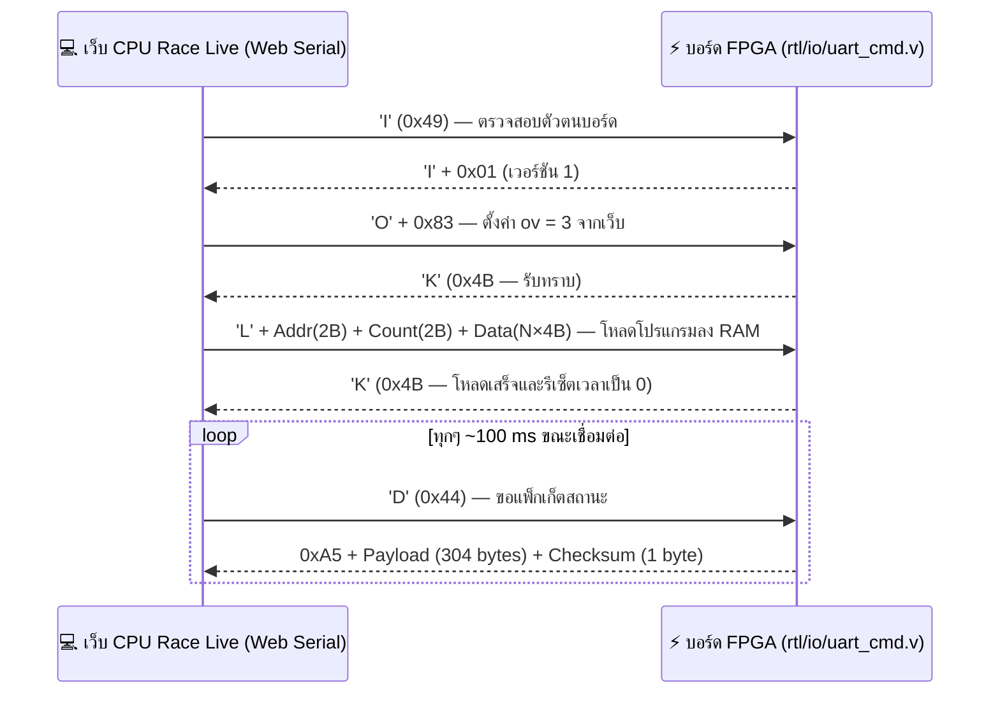

# 🔌 โปรโตคอล UART ระหว่างเว็บกับบอร์ด FPGA

> [!NOTE]
> โปรโตคอลนี้ใช้สื่อสารระหว่างเว็บแอปพลิเคชัน **CPU Race Live** ([`web-live/`](../web-live/)) กับวงจรบนบอร์ด FPGA
> - **ฝั่งฮาร์ดแวร์ (Verilog):** [`rtl/io/uart_cmd.v`](../rtl/io/uart_cmd.v), [`uart_rx.v`](../rtl/io/uart_rx.v), [`uart_tx.v`](../rtl/io/uart_tx.v)
> - **ฝั่งเว็บ (JavaScript):** [`web-live/protocol.js`](../web-live/protocol.js)
> - **การทดสอบอัตโนมัติ:** [`sim/test_uart.js`](../sim/test_uart.js) (ถูกเรียกโดย `python sim/run_all.py`)

---

## 🔗 1. พารามิเตอร์การเชื่อมต่อ

- **สายสัญญาณ:** สาย Micro-USB เส้นเดียวกับที่ใช้จ่ายไฟและโหลด Bitstream (ชิป FTDI FT2232H, USB Vendor ID `0x0403`) โดยคอมพิวเตอร์จะมองเห็นเป็นพอร์ต `COM` มาตรฐาน
- **การตั้งค่า Serial:** **`115200 baud`, `8 data bits`, `No parity`, `1 stop bit` (`8N1`), `No flow control`**
- **ขาพอร์ตบนบอร์ด Nexys A7-100T:**
  - `UART_TXD_IN` (ขา `C4`: คอมพิวเตอร์ → FPGA)
  - `UART_RXD_OUT` (ขา `D4`: FPGA → คอมพิวเตอร์)
- **รูปแบบการคุย (Request–Response):** ส่งทีละคำสั่งและรอรับคำตอบให้ครบก่อนส่งคำสั่งถัดไป (บอร์ดจะไม่รับคำสั่งใหม่ในขณะที่กำลังส่งข้อมูลตอบกลับอยู่)



---

## 📨 2. ตารางคำสั่ง (คอมพิวเตอร์ → บอร์ด FPGA)

| คำสั่ง | ไบต์ที่ส่งไป | ไบต์ตอบกลับ | รายละเอียดการทำงาน |
|---|---|:-:|---|
| **ระบุตัวตน (Identify)** | `'I'` (`0x49`) | `'I'` + `0x01` | ใช้เช็กว่าพอร์ตที่เปิดเป็นบอร์ด CPU Race จริง (เวอร์ชันโปรโตคอล = `1`) |
| **ขอสถานะ (Dump)** | `'D'` (`0x44`) | `306 bytes` | ส่งแพ็กเก็ตสถานะของทั้งระบบกลับมา (ดูโครงสร้างในหัวข้อ 3) |
| **ก้าว 1 จังหวะ (Step)** | `'S'` (`0x53`) | `'K'` (`0x4B`) | เหมือนการกดปุ่มกลาง `BTNC` บนบอร์ด |
| **เริ่มวิ่ง (Go / Run)** | `'G'` (`0x47`) | `'K'` | เริ่มวิ่งแข่งขัน (ต้องอยู่ในโหมด Run) |
| **หยุดชั่วคราว (Pause)** | `'P'` (`0x50`) | `'K'` | หยุดการวิ่งชั่วคราว |
| **เริ่มใหม่ (Reset)** | `'R'` (`0x52`) | `'K'` | รีเซ็ต CPU ทั้งสองตัวและตั้งเวลา `TIME = 0` โดยใช้โปรแกรมเดิมใน Memory |
| **โหลดโปรแกรม Demo** | `'B'` + `n` | `'K'` | `n = 0` (โปรแกรม A) หรือ `n = 1` (โปรแกรม B) เหมือนการกดปุ่มซ้าย `BTNL` |
| **ตั้งค่า `ov`** | `'O'` + `v` | `'K'` | `v = 0x80 \| ov` ใช้ค่า `ov` จากเว็บ · `v = 0x00` คืนสิทธิ์กลับไปใช้สวิตช์ `SW3–0` บนบอร์ด |
| **ตั้งโหมดและความเร็ว** | `'M'` + `v` | `'K'` | `v = 0x80 \| (run << 3) \| speed` ใช้ค่าจากเว็บ · `v = 0x00` คืนสิทธิ์กลับไปใช้ `SW15`, `SW14–12` |
| **ยกเลิกการแทนค่า** | `'X'` (`0x58`) | `'K'` | คืนสิทธิ์ทั้งค่า `ov` และโหมดการทำงานกลับไปอ่านจากสวิตช์บนบอร์ดทั้งหมด |
| **เขียนหน่วยความจำ** | `'L'` + `a_hi a_lo n_hi n_lo` + `n×4 bytes` | `'K'` | เขียนข้อมูลจำนวน `n` words (Big-endian) ลงใน Memory ของทั้งสอง CPU เริ่มที่ Word Address `a` (`0–255` = `.text`, `256–511` = `.data`) ระหว่างโหลด CPU จะอยู่ในสถานะ Reset และเริ่มใหม่ที่เวลา `0` ทันทีเมื่อโหลดครบ (มีระบบ Timeout ยกเลิกอัตโนมัติหากข้อมูลขาดหายเกิน ~0.3 วินาที) |
| **คำสั่งอื่นๆ ที่ไม่รู้จัก** | *ใดๆ* | `'?'` (`0x3F`) | แจ้งเตือนว่าไม่รู้จักคำสั่ง |

---

## 📦 3. โครงสร้างแพ็กเก็ตสถานะ 306 ไบต์ (คำตอบของคำสั่ง `'D'`)

รูปแบบเฟรม: **`0xA5` (Header 1 byte)** + **Payload (304 bytes)** + **Checksum (1 byte = ผลรวมของทุกไบต์ใน Payload `mod 256`)**
*(ข้อมูลขนาด 32-bit ทุกตัวเรียงลำดับแบบ **Big-endian**)*

| ช่วงไบต์ของ Payload | ขนาด | ข้อมูลข้างใน |
|:---:|:---:|---|
| `0 – 3` | 4 B | `time` — เวลาร่วมปัจจุบันของระบบ (32-bit) |
| `4` | 1 B | ค่า `ov` ที่ใช้งานอยู่จริงในขณะนั้น (`bit[3:0]`) |
| `5` | 1 B | **สถานะ Flags (8-bit):**<br/>• `bit 0`: Single-cycle จบแล้ว (`done_s`)<br/>• `bit 1`: Multicycle จบแล้ว (`done_m`)<br/>• `bit 2`: กำลังวิ่งอยู่ (`running`)<br/>• `bit 3`: โปรแกรมที่โหลดคือโปรแกรม B<br/>• `bit 4`: อยู่ในโหมด Run (`run_mode`)<br/>• `bit 5`: ค่า `ov` ถูกควบคุมจากเว็บ<br/>• `bit 6`: โหมด/ความเร็วถูกควบคุมจากเว็บ<br/>• `bit 7`: กำลังโหลดหน่วยความจำ (`loading`) |
| `6` | 1 B | ระดับความเร็ว (`speed` ใน `bit[2:0]`) |
| `7` | 1 B | สถานะ FSM ปัจจุบันของ Multicycle (`state` ใน `bit[3:0]`, ค่า `0–11`) |
| `8 – 27` | 20 B | 🟠 **สถานะ Single-cycle (5 × 32-bit):** `PC`, `instr`, `retired`, `time_last_step`, `active_s` (ดูบิตใน [`wire_map.md`](wire_map.md)) |
| `28 – 47` | 20 B | 🔵 **สถานะ Multicycle (5 × 32-bit):** `PC`, `IR`, `retired`, `time_last_step`, `active_m` |
| `48 – 175` | 128 B | 🟠 **ค่า Register `$0` ถึง `$31` ของ Single-cycle** (32 × 4 bytes) |
| `176 – 303` | 128 B | 🔵 **ค่า Register `$0` ถึง `$31` ของ Multicycle** (32 × 4 bytes) |

> [!TIP]
> - ไบต์ที่ `0–47` ของ Payload จะถูกถ่ายภาพนิ่ง (Snapshot) เก็บไว้พร้อมกันในจังหวะที่เริ่มส่งแพ็กเก็ต เพื่อให้ค่าสถานะทั้งชุดสอดคล้องกันในเวลาเดียวกันเป๊ะ
> - การส่งข้อมูล 306 ไบต์ที่ความเร็ว `115200 bps` ใช้เวลาเพียง **~27 ms** ทำให้หน้าเว็บสามารถดึงสถานะสดทุกๆ ~100 ms (10 ครั้งต่อวินาที) ได้อย่างลื่นไหล

---

## 💻 4. ตัวอย่างการรับ-ส่งข้อมูลจริง (Hex Stream)

```text
คอมพิวเตอร์ → 49                                  # ส่ง 'I' ขอระบุตัวตน
บอร์ด FPGA  ← 49 01                               # ตอบ 'I' พร้อมเลขเวอร์ชัน 1

คอมพิวเตอร์ → 4F 83                               # ส่ง 'O' (0x4F) ตามด้วย 0x83 (ตั้ง ov = 3 จากเว็บ)
บอร์ด FPGA  ← 4B                                  # ตอบ 'K' (0x4B)

คอมพิวเตอร์ → 4C 00 00 01 00 + [ข้อมูล 1024 ไบต์]  # ส่ง 'L' เขียน 256 words เริ่มที่ Address 0
บอร์ด FPGA  ← 4B                                  # ตอบ 'K' เมื่อเขียนครบและรีเซ็ตเรียบร้อย

คอมพิวเตอร์ → 44                                  # ส่ง 'D' ขอแพ็กเก็ตสถานะ
บอร์ด FPGA  ← A5 [Payload 304 ไบต์] [Checksum]    # ตอบกลับ 306 ไบต์
```
