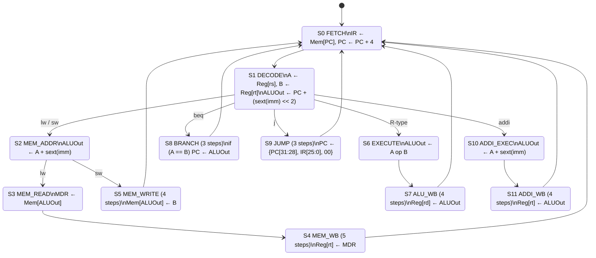
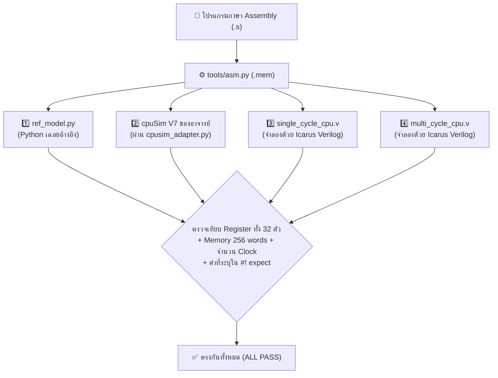

# 📖 บทเรียน: CPU ทำงานยังไง และ Single-cycle ต่างจาก Multicycle ยังไง

> [!NOTE]
> บทเรียนนี้ออกแบบมาสำหรับผู้ที่เริ่มต้นจากศูนย์ แม้ไม่เคยเรียนวิชาสถาปัตยกรรมคอมพิวเตอร์มาก่อนก็สามารถอ่านเข้าใจได้ทันที
> - ใช้ศึกษาควบคู่กับโค้ดจริงในโปรเจคนี้ โดยทุกตัวอย่างสามารถรันดูผลจริงได้ด้วยคำสั่ง `python sim/trace.py ...` (ดูวิธีใช้ใน [`manual.md`](manual.md))
> - อ้างอิงเนื้อหาจากสไลด์รายวิชา Computer Architecture: `w01b` (Performance), `w02a` (ISA), `w04a` (Single-cycle), `w04c` (Multicycle)

---

## 🧭 วิธีอ่านบทเรียนนี้

แต่ละหัวข้อแบ่งคำอธิบายออกเป็น **3 ระดับ** ไล่จากง่ายไปยาก เพียงอ่านระดับแรก (`🟢`) ก็เข้าใจภาพรวมทั้งหมดได้แล้ว:

| สัญลักษณ์ | ระดับเนื้อหา | เหมาะสำหรับ |
|:---:|---|---|
| 🟢 | **ภาษาชาวบ้าน:** เปรียบเทียบกับเรื่องใกล้ตัวในชีวิตประจำวัน | ทุกคนที่ต้องการเข้าใจแนวคิดหลัก |
| 🟡 | **ภาษาในห้องเรียน:** คำศัพท์ทางวิศวกรรมที่ตรงกับสไลด์การสอน | ผู้ที่เตรียมตัวสอบหรือเตรียมนำเสนอหน้าชั้นเรียน |
| 🔴 | **ในโค้ดของเรา:** ชี้ไปยังไฟล์และบรรทัดจริงในโปรเจค | ผู้ที่ต้องการอ่านหรือแก้ไขโค้ด Verilog / Python |

---

## 📑 สารบัญ

1. [CPU คืออะไร](#1-cpu-คืออะไร)
2. [คำสั่งคือตัวเลข (Machine Code)](#2-คำสั่งคือตัวเลข-machine-code)
3. [ชุดคำสั่ง MIPS 10 ตัวของเรา](#3-ชุดคำสั่ง-10-ตัวของเรา)
4. [Clock: จังหวะหัวใจของวงจร](#4-clock-จังหวะของวงจร)
5. [Single-cycle CPU](#5-single-cycle-cpu)
6. [Multicycle CPU](#6-multicycle-cpu)
7. [การแข่ง: ใครเร็วกว่ากันจริงๆ (Performance Paradox)](#7-การแข่ง-ใครเร็วกว่ากันจริงๆ)
8. [โปรเจคของเราประกอบกันยังไง](#8-โปรเจคของเราประกอบกันยังไง)
9. [แบบฝึกหัดทบทวน (พร้อมเฉลย)](#9-แบบฝึกหัด)
10. [พจนานุกรมคำศัพท์ย่อ](#10-คำศัพท์)

---

## 1. CPU คืออะไร

### 🟢 ภาษาชาวบ้าน: CPU คือพ่อครัวที่ทำตามสูตรทีละบรรทัด

ลองนึกภาพห้องครัวในร้านอาหารแห่งหนึ่ง:

| สิ่งของในห้องครัว | ส่วนประกอบในคอมพิวเตอร์ | หน้าที่การทำงาน |
|---|---|---|
| สมุดสูตรอาหาร | **โปรแกรม (Program)** | รายการคำสั่งที่เขียนเรียงไว้ทีละบรรทัด |
| นิ้วที่ชี้บรรทัดที่กำลังทำ | **PC (Program Counter)** | ตัวจำว่าตอนนี้กำลังทำอยู่บรรทัดที่เท่าไร |
| ตู้เย็น / ตู้เก็บวัตถุดิบ | **Memory (หน่วยความจำ)** | เก็บของได้เยอะมาก แต่ต้องใช้เวลาเดินไปหยิบ |
| ถาดวางของบนเขียงใกล้มือ | **Register File** | ที่วางของติดตัวพ่อครัว มีแค่ 32 ช่อง แต่หยิบใช้ได้ทันที |
| มีด / เครื่องปั่น / เตาไฟ | **ALU (Arithmetic Logic Unit)** | อุปกรณ์ลงมือคำนวณ: บวก ลบ เปรียบเทียบค่า |
| หัวหน้าเชฟผู้สั่งการ | **Control Unit** | คนอ่านสูตรแล้วตะโกนสั่งว่าต้องเปิดตู้ไหน ใช้มีดอะไร |

พ่อครัวทำงานวนลูปซ้ำเดิมไปเรื่อยๆ:
1. **ดู (Fetch):** อ่านสูตรบรรทัดที่นิ้วชี้อยู่
2. **ตีความและทำ (Decode & Execute):** หยิบของบนเขียงมาหั่น ผสม หรือเดินไปตู้เย็นแล้วนำผลลัพธ์มาวางเก็บ
3. **เลื่อนนิ้ว (Next PC):** เลื่อนนิ้วไปบรรทัดถัดไป (หรือกระโดดไปบรรทัดอื่นถ้าสูตรสั่ง เช่น *"ถ้ายังไม่สุก ให้กลับไปทำข้อ 3 ซ้ำ"*)

ทั้งหมดนี้คือการทำงานของ **CPU (Central Processing Unit)**

### 🟡 ภาษาในห้องเรียน: วงจร Fetch → Decode → Execute

CPU ทำงาน 3 ขั้นตอนหลักวนไปไม่รู้จบ:
- **Fetch:** อ่านคำสั่งจากหน่วยความจำที่ตำแหน่ง `Address = PC`
- **Decode:** แยกส่วนของคำสั่งออกมาดูว่าเป็นคำสั่งชนิดใด และต้องอ่านค่าจาก Register ตัวไหน
- **Execute:** ประมวลผลตามคำสั่ง แล้วอัปเดตค่า `PC` (ปกติคือ `PC + 4` เพื่อชี้ไปยังคำสั่งถัดไป)

ภายใน CPU แบ่งออกเป็น 2 ส่วนหลัก (ตามสไลด์ `w04a`):
- **Datapath (ทางเดินข้อมูล):** ประกอบด้วย Register, ALU, Memory, Multiplexer (Mux) และสายไฟที่เชื่อมถึงกัน
- **Control (หน่วยควบคุม / สมอง):** ถอดรหัสคำสั่งแล้วสร้างสัญญาณควบคุมเพื่อสั่งเปิด/ปิดทางเดินข้อมูลใน Datapath

### 🔴 ในโค้ดของเรา

- **Datapath ของ Single-cycle:** [`rtl/single/single_cycle_cpu.v`](../rtl/single/single_cycle_cpu.v)
- **Control ของ Single-cycle:** [`rtl/single/sc_control.v`](../rtl/single/sc_control.v)
- **ชิ้นส่วนที่ใช้ร่วมกันทั้งสอง CPU (`ALU`, `Register File`, `Sign-Extend`):** [`rtl/common/`](../rtl/common/)

> [!TIP]
> **คำว่า "Mux" (Multiplexer)** เปรียบเสมือน **"สวิตช์สับรางรถไฟ"** ที่มีทางเข้าหลายทางแต่มีทางออกทางเดียว โดยมีสัญญาณ Control เป็นคนโยกว่าจะให้รางไหนผ่านเข้าสู่ทางออก สไลด์ `w04a` หน้า 5 เน้นว่า *"Can't just join wires together → use multiplexers"* เพราะถ้านำสายไฟสองเส้นมาต่อชนกันตรงๆ สัญญาณไฟจะลัดวงจรชนกัน

---

## 2. คำสั่งคือตัวเลข (Machine Code)

### 🟢 ภาษาชาวบ้าน

วงจรไฟฟ้าอ่านตัวหนังสือภาษาอังกฤษไม่ออก คำสั่งอย่าง `add $t2, $t0, $t1` จึงต้องถูกแปลงเป็นรหัสตัวเลขก่อน เหมือนเวลาลูกค้าสั่ง *"ข้าวผัดกุ้งไม่ใส่ผัก"* แต่พนักงานจดลงบิลเป็นรหัส `A3-07-N` เพื่อให้คนในครัวเข้าใจตรงกันทันที

โปรแกรมที่ทำหน้าที่แปลงคำสั่งตัวหนังสือให้เป็นรหัสตัวเลขเรียกว่า **Assembler** (ในโปรเจคของเราคือ [`tools/asm.py`](../tools/asm.py))

### 🟡 ภาษาในห้องเรียน: 3 รูปแบบคำสั่ง (Formats) ยาว 32-bit เท่ากันหมด

```text
R-format  │ opcode │  rs   │  rt   │  rd   │ shamt │ funct │
          │ 6 bit  │ 5 bit │ 5 bit │ 5 bit │ 5 bit │ 6 bit │

I-format  │ opcode │  rs   │  rt   │      immediate        │
          │ 6 bit  │ 5 bit │ 5 bit │        16 bit         │

J-format  │ opcode │             target address             │
          │ 6 bit  │                26 bit                  │
```

- **`opcode` (6-bit):** บอกว่าเป็นคำสั่งกลุ่มใด
- **`rs`, `rt` (5-bit):** หมายเลข Register ต้นทางที่จะอ่าน (5 บิต แทนเลข `0–31` พอดีกับจำนวน 32 Registers)
- **`rd` (5-bit):** หมายเลข Register ปลายทางที่จะเขียนผลลัพธ์ (เฉพาะ `R-format`)
- **`funct` (6-bit):** รหัสย่อยที่ระบุว่า `R-format` ตัวนี้คือคำสั่ง `add`, `sub`, `and`, `or` หรือ `slt`
- **`immediate` (16-bit):** ค่าคงที่ที่ฝังมาในคำสั่งโดยตรง

#### ตัวอย่างการแปลงคำสั่งจริง (ตรงกับสไลด์ `w02a` หน้า 36)

1. **`add $t2, $t0, $t1`** (`R-format`: `$t0` = 8, `$t1` = 9, `$t2` = 10):
   ```text
   opcode   rs      rt      rd      shamt   funct
   000000   01000   01001   01010   00000   100000
     0        8       9       10      0      0x20

   เรียงเป็น 32 bit: 0000 0001 0000 1001 0101 0000 0010 0000
   แปลงเป็น Hex:     0    1    0    9    5    0    2    0     = 0x01095020
   ```

2. **`lw $t0, 0x400($zero)`** (`I-format`):
   ```text
   opcode   rs      rt      immediate
   100011   00000   01000   0000 0100 0000 0000
    0x23      0       8         0x0400            = 0x8c080400
   ```

> [!NOTE]
> **ทำไมทุกคำสั่งของ MIPS จึงยาว 32-bit เท่ากันหมด?**
> สไลด์ `w02a` กล่าวไว้ว่า *"Design Principle 1: Simplicity favors regularity"* เมื่อทุกคำสั่งมีความยาวเท่ากัน วงจรหยิบคำสั่งจึงออกแบบง่ายมาก เพียงบวก `PC + 4` ทุกครั้ง (4 bytes = 32 bits) ต่างจากสถาปัตยกรรม x86 ที่คำสั่งมีความยาวตั้งแต่ 1 ถึง 15 bytes ซึ่งต้องใช้วงจรถอดรหัสที่ซับซ้อนกว่ามาก
> นอกจากนี้ เรายังนิยมเขียนเป็น **เลขฐานสิบหก (Hexadecimal)** เพราะ 1 หลัก Hex แทนค่าได้ 4 บิตพอดี ทำให้อ่านง่ายกว่าเลขฐานสองยาว 32 ตัว

### 🔴 ในโค้ดของเรา

- **Assembler ([`tools/asm.py`](../tools/asm.py)):** ประกอบบิตของ `R-format` ด้วยนิพจน์ `(rs << 21) | (rt << 16) | (rd << 11) | funct`
- **ฝั่งวงจร Verilog ([`rtl/single/single_cycle_cpu.v`](../rtl/single/single_cycle_cpu.v)):** แยกแต่ละช่องออกด้วย `instr[25:21]` (`rs`), `instr[20:16]` (`rt`), `instr[15:11]` (`rd`)

---

## 3. ชุดคำสั่ง 10 ตัวของเรา

### 🟢 ภาษาชาวบ้าน

CPU ของเรารู้จักคำสั่งพื้นฐานเพียง **10 คำสั่ง** แต่สามารถนำมาประกอบกันเพื่อเขียนโปรแกรมคำนวณ วนลูป และจัดการข้อมูลได้เกือบทุกชนิด เปรียบเหมือนตัวต่อเลโก้ที่มีไม่กี่รูปร่างแต่ต่อเป็นปราสาทได้:

| กลุ่มคำสั่ง | คำสั่ง | ความหมายเข้าใจง่าย | ตัวอย่างการใช้งาน |
|---|---|---|---|
| **คำนวณ (ALU)** | `add rd, rs, rt` | `rd = rs + rt` | `add $t2, $t0, $t1` |
| | `sub rd, rs, rt` | `rd = rs − rt` | `sub $t3, $t1, $t0` |
| | `and rd, rs, rt` | นำบิตมา `AND` กันทีละตำแหน่ง | `and $t2, $t0, $t1` |
| | `or rd, rs, rt` | นำบิตมา `OR` กันทีละตำแหน่ง | `or $t3, $t0, $t1` |
| | `slt rd, rs, rt` | ถ้า `rs < rt` ให้ `rd = 1` มิฉะนั้น `rd = 0` | `slt $t3, $t1, $t2` |
| | `addi rt, rs, imm` | `rt = rs + ค่าคงที่` | `addi $t0, $zero, 5` |
| **หน่วยความจำ** | `lw rt, off(rs)` | หยิบข้อมูลจาก Memory ช่อง `rs + off` มาใส่ `rt` | `lw $t0, 0($t1)` |
| | `sw rt, off(rs)` | นำค่าใน `rt` ไปเก็บลง Memory ช่อง `rs + off` | `sw $t0, 4($t1)` |
| **กระโดด / ลูป** | `beq rs, rt, label` | ถ้า `rs == rt` ให้กระโดดไปที่ `label` | `beq $t3, $zero, done` |
| | `j label` | กระโดดไปที่ `label` เสมอ | `j loop` |

### 🟡 ภาษาในห้องเรียน: รายละเอียดสำคัญที่ต้องระวัง

- **`$zero` (`$0`) มีค่าเป็น `0` เสมอ:** ไม่ว่าจะเขียนค่าใดทับลงไปก็จะยังคงเป็น `0` ใช้ทำคำสั่งพื้นฐานได้หลากหลาย เช่น `addi $t0, $zero, 5` (ตั้งค่าเริ่มต้นให้ `$t0 = 5`) หรือ `add $t1, $t0, $zero` (คัดลอกค่าระหว่าง Register)
- **`slt` เปรียบเทียบแบบมีเครื่องหมาย (Signed Comparison):** ค่า `0xFFFFFFFF` คือ `-1` (น้อยกว่า `0`) ไม่ใช่ 4 พันล้าน
- **`addi` ขยายเครื่องหมาย (Sign-extend):** แปลงค่าคงที่ 16-bit ให้เป็น 32-bit ก่อนนำไปบวก เช่น `0xFFFF` จะถูกขยายเป็น `0xFFFFFFFF` (`-1`) ตามสไลด์ `w02a` หน้า 32
- **`beq` นับระยะกระโดดเป็นจำนวนคำสั่งต่อจาก `PC + 4`:** คำนวณเป้าหมายจาก $\text{PC}_{\text{target}} = (\text{PC} + 4) + (\text{sign\_ext}(\text{offset}) \times 4)$
- **`j` ใช้การต่อบิต (Concatenation):** คำนวณเป้าหมายจาก $\text{PC}_{\text{target}} = \{\text{PC}+4[31:28], \text{target}[25:0], 2'\text{b}00\}$ (สไลด์ `w04a` หน้า 34)

### 🔴 ในโค้ดของเรา: การจบโปรแกรม (`halt`)

เนื่องจากฮาร์ดแวร์ของเราทำงานแบบ Bare-metal ไม่มีระบบปฏิบัติการมารับคำสั่ง `syscall` เหมือนในโปรแกรมจำลอง SPIM เราจึงกำหนดข้อตกลงว่า **คำสั่ง `j` ที่กระโดดกลับมาหาตำแหน่งของตัวเอง คือจุดจบของโปรแกรม (`halt`)**:

```asm
halt:   j    halt       # หรือเขียนสั้นๆ ว่า halt (Assembler จะแปลงให้เอง)
```

วงจรฮาร์ดแวร์จะตรวจว่าคำสั่งที่ `PC` ชี้อยู่เป็นคำสั่ง `j` ที่ชี้เป้ากลับมาหา `PC` ปัจจุบันหรือไม่ หากใช่จะยกสัญญาณ `done = 1` และหยุดเดินทันทีโดยไม่นับคำสั่ง `halt` รวมในจำนวนคำสั่งที่รัน (`retired`)

---

## 4. Clock: จังหวะของวงจร

### 🟢 ภาษาชาวบ้าน

ลองนึกถึงขบวนพาเหรดวงโยธวาทิตที่ทุกคนก้าวเท้าพร้อมกันตามเสียงตีกลองใหญ่ **"ตุ้ม!"**
- ระหว่างที่รอเสียงกลองครั้งถัดไป ทุกคนจะเตรียมตัวและคิดคำนวณท่าทาง
- ทันทีที่เสียงกลองดัง **"ตุ้ม!"** ทุกคนจะก้าวเท้าเปลี่ยนตำแหน่งพร้อมกันทันที
- **กฎเหล็ก:** จังหวะตีกลองต้อง **ห่างพอให้คนที่คิดท่าช้าที่สุดในขบวนเตรียมตัวทัน** ถ้าตีกลองถี่เกินไป คนที่ยังเตรียมตัวไม่เสร็จจะก้าวผิดจังหวะและทำให้ขบวนรวนทั้งหมด

### 🟡 ภาษาในห้องเรียน

- **Sequential Elements (Register, Memory ขณะเขียน):** เปลี่ยนแปลงค่าที่เก็บไว้เฉพาะตรงขอบขาขึ้นของสัญญาณนาฬิกา (`posedge clk`) เท่านั้น (สไลด์ `w04a` หน้า 13)
- **Combinational Elements (ALU, Mux, Adder, Sign-extend):** ค่าเอาต์พุตเปลี่ยนตามอินพุตตลอดเวลา แต่ต้องใช้เวลาในการเดินทางของสัญญาณผ่านเกต (**Propagation Delay**)
- **ความยาวคาบสัญญาณนาฬิกา ($T_{\text{clock}}$) ต้องยาวกว่าหรือเท่ากับเส้นทางที่ช้าที่สุด (Critical Path)** (สไลด์ `w04a` หน้า 15: *"Longest delay determines clock period"*)
- **สมการเวลาทำงานของโปรแกรม** (สไลด์ `w01b` หน้า 12):

$$\text{Execution Time} = \text{Instruction Count (IC)} \times \text{CPI} \times T_{\text{clock}}$$

### 🔴 ในโค้ดของเรา

บอร์ด Nexys A7-100T มีสัญญาณนาฬิกาหลัก 100 MHz ซึ่งเราลดความถี่ลงมาเป็น **25 MHz** สำหรับใช้ทั้งระบบ แต่ CPU ของเราไม่ได้ก้าวเดินทุกจังหวะ 25 MHz — มันจะเดินเฉพาะเมื่อได้รับสัญญาณอนุญาต `en` (Enable) จากตัวคุมการแข่ง (`race_ctrl.v`) เท่านั้น:

```verilog
wire step = en & ~done;          // ก้าวเดินเมื่อได้รับสัญญาณ en และโปรแกรมยังไม่จบ
always @(posedge clk) begin
    if (rst)
        pc_r <= 32'd0;
    else if (step)
        pc_r <= pc_next;         // PC อัปเดตค่าใหม่เฉพาะจังหวะที่มี step
end
```

---

## 5. Single-cycle CPU

### 🟢 ภาษาชาวบ้าน: ร้านอาหารที่ทุกเมนูต้องจองเวลาเท่ากัน

ลองนึกถึงร้านอาหารที่มีกฎว่า **ทุกออเดอร์ต้องใช้เวลาทำ 50 นาทีเท่ากันหมด**
- **ทำไมต้อง 50 นาที?** เพราะเมนูที่ใช้เวลานานที่สุดในร้าน (เช่น สเต๊กอบ) ใช้เวลา 50 นาที
- แม้ลูกค้าจะสั่งแค่น้ำเปล่า (ซึ่งรินใส่แก้วเสร็จใน 5 นาที) ก็ต้องนั่งรอให้ครบ 50 นาทีจึงจะเสิร์ฟออเดอร์ถัดไปได้
- **ข้อดี:** จัดคิวง่ายมาก เพราะ 1 ออเดอร์ = 1 ช่องเวลาเท่ากันเสมอ (`CPI = 1`)
- **ข้อเสีย:** เสียเวลาไปโดยเปล่าประโยชน์กับเมนูง่ายๆ ที่ทำเสร็จไปตั้งนานแล้ว

### 🟡 ภาษาในห้องเรียน: ข้อมูลไหลผ่านทั้ง Datapath ภายใน 1 Clock

```text
 ┌────┐   ┌──────┐   ┌──────────┐   ┌─────┐   ┌──────┐   ┌──────────┐
 │ PC │──►│ IMEM │──►│ RegFile  │──►│ ALU │──►│ DMEM │──►│ RegFile  │
 └────┘   └──────┘   │ (อ่าน)   │   └─────┘   └──────┘   │ (เขียน)  │
   ▲                 └──────────┘                         └──────────┘
   │     ① Fetch      ② Decode     ③ Execute  ④ Memory   ⑤ Write Back
   └──── PC+4 / Branch / Jump  (อัปเดตพร้อมกันที่ขอบ Clock ถัดไป)
```

- **ทำไมต้องแยก `IMEM` กับ `DMEM` เป็น 2 ก้อน?** เพราะภายใน 1 Clock เดียว คำสั่ง `lw` ต้องอ่านทั้งรหัสคำสั่งและอ่านข้อมูลจากหน่วยความจำพร้อมกัน จึงใช้หน่วยความจำก้อนเดียวไม่ได้ (สไลด์ `w04a` หน้า 22)
- **เส้นทางวิกฤตที่ยาวที่สุด (Critical Path) คือคำสั่ง `lw`:** ข้อมูลต้องเดินทางผ่านครบทั้ง 5 ส่วน (`IMEM → RegFile → ALU → DMEM → RegFile`)

#### ตารางสัญญาณควบคุมหลัก (Main Control — สไลด์ `w04a`)

| สัญญาณ | เมื่อมีค่าเป็น `1` หมายถึง | เปรียบเทียบในห้องครัว |
|---|---|---|
| `RegDst` | เลือกเขียนผลลงช่อง `rd` (ของ `R-type`) แทนช่อง `rt` | วางอาหารลงจานใบที่ 3 แทนจานใบที่ 2 |
| `ALUSrc` | ส่งค่า Immediate เข้าขาที่สองของ ALU แทนค่าจาก Register | ใช้ตัวเลขที่ระบุในสูตรแทนวัตถุดิบในถาด |
| `MemtoReg` | นำค่าที่อ่านจาก Data Memory (`lw`) ไปเขียนลง Register แทนผลจาก ALU | นำของที่หยิบจากตู้เย็นไปเสิร์ฟ |
| `RegWrite` | อนุญาตให้บันทึกค่าใหม่ลงใน Register File | วางของเก็บลงถาดบนเขียง |
| `MemRead` | อ่านข้อมูลจาก Data Memory (`DMEM`) | เปิดตู้เย็นหยิบของ |
| `MemWrite` | เขียนข้อมูลลง Data Memory (`DMEM`) | นำของไปแช่เก็บในตู้เย็น |
| `Branch` | เป็นคำสั่งกระโดดแบบมีเงื่อนไข (`beq`) | ถ้าเงื่อนไขตรง ให้ข้ามไปทำบรรทัดที่ระบุ |
| `Jump` | เป็นคำสั่งกระโดดแบบไม่มีเงื่อนไข (`j`) | กระโดดไปบรรทัดเป้าหมายทันที |
| `ALUOp` | สั่ง ALU Control ว่าให้บวก (`00`), ลบ (`01`) หรือดูรหัส `funct` (`10`) | สั่งพ่อครัวว่าจะหั่นสับหรือปั่น |

#### ตัวอย่างการไล่การทำงานของ `lw $t0, 0x400($zero)` ภายใน 1 Clock

| ลำดับ | ขั้นตอนที่เกิดขึ้นภายใน 1 Clock | ค่าในวงจร |
|:---:|---|---|
| ① | `PC` ชี้ที่ `0x0000` → อ่านรหัสคำสั่งออกมาจาก `IMEM` | `instr = 0x8c080400` |
| ② | แยกบิตได้ `rs = 0`, `rt = 8`, `imm = 0x0400` → อ่านค่า `$0` และขยายเครื่องหมาย `imm` | `ReadData1 = 0`, `ext = 0x00000400` |
| ③ | สัญญาณ `ALUSrc = 1` เลือกค่า `ext` → `ALU` คำนวณ `0 + 0x400` | `alu_y = 0x00000400` |
| ④ | สัญญาณ `MemRead = 1` → อ่านข้อมูลจาก `DMEM` ที่ตำแหน่ง `0x400` | `dmem_rdata = 30` (`0x1e`) |
| ⑤ | `MemtoReg = 1, RegDst = 0` → ส่งค่า `30` ไปรอที่ขาเขียนของ `$t0` (`$8`) | `wb_data = 30` |
| ⑥ | **เมื่อขอบขาขึ้นของ Clock มาถึง:** บันทึก `30` ลงใน `$t0` และอัปเดต `PC = 4` พร้อมกัน | `$t0 = 30`, `PC = 4` |

### 🔴 ในโค้ดของเรา

ในไฟล์ [`rtl/single/single_cycle_cpu.v`](../rtl/single/single_cycle_cpu.v) โครงสร้างโค้ดจัดเรียงตามลำดับขั้นตอน ① ถึง ⑥ อย่างชัดเจน โดยส่วนคำนวณทั้งหมดเขียนด้วย `assign` (Combinational Logic) และมีเพียง `pc_r`, `regfile` และ `dmem` เท่านั้นที่อัปเดตค่าในบล็อก `always @(posedge clk)`

> [!IMPORTANT]
> **ทำไมในโลกจริงจึงไม่มีใครผลิต CPU แบบ Single-cycle ขายเชิงพาณิชย์?**
> เพราะความเร็ว Clock ถูกถ่วงด้วยคำสั่งที่ช้าที่สุดเสมอ สไลด์ `w04a` หน้า 36 สรุปไว้ชัดเจนว่า *"Violates design principle: Making the common case fast"* แต่ Single-cycle ยังคงเป็นจุดเริ่มต้นที่ดีที่สุดในการเรียนรู้ เพราะทำให้มองเห็นการไหลของข้อมูลครบทั้งคำสั่งได้ในภาพเดียว

---

## 6. Multicycle CPU

### 🟢 ภาษาชาวบ้าน: ร้านอาหารที่แบ่งงานเป็นช่วงสั้นๆ ช่วงละ 10 นาที

ร้านอาหารแห่งที่สองเปลี่ยนกติกาใหม่: **ซอยเวลาทำงานออกเป็นช่วงสั้นๆ ช่วงละ 10 นาที** โดยแต่ละเมนูใช้จำนวนช่วงเท่าที่จำเป็นจริง:
- **สั่งน้ำเปล่า (`beq`, `j`):** ใช้แค่ 3 ช่วง = **30 นาที** เสร็จแล้วเสิร์ฟได้เลย!
- **สั่งข้าวผัด (`R-type`, `sw`, `addi`):** ใช้ 4 ช่วง = **40 นาที**
- **สั่งสเต๊ก (`lw`):** ใช้ 5 ช่วง = **50 นาที**

นอกจากเมนูสั้นจะเสร็จเร็วขึ้นแล้ว ยังสามารถ **ใช้อุปกรณ์ชิ้นเดิมซ้ำในคนละช่วงเวลาได้** (เช่น ใช้ Memory ก้อนเดียวและ ALU ตัวเดียวสลับกันทำงานในแต่ละช่วง)

แต่มีสิ่งที่ต้องแลกมา 3 ข้อ:
1. **ต้องมีถาดพักของระหว่างช่วง:** คือ Register พิเศษที่คั่นอยู่ระหว่างทาง ได้แก่ **`IR`, `MDR`, `A`, `B`, `ALUOut`**
2. **ต้องมีสมองคอยจำว่าตอนนี้อยู่ช่วงที่เท่าไร:** คือวงจร **FSM (Finite State Machine)**
3. **ทุกครั้งที่จบ 1 ช่วง ต้องเสียเวลาวางของลงถาดพัก:** นี่คือค่า **Overhead (`ov`)** ซึ่งถ้าเสียเวลาวางของนานเกินไป การซอยเป็นหลายช่วงอาจทำให้ช้ากว่าเดิม!

### 🟡 ภาษาในห้องเรียน: แบ่งคำสั่งเป็นหลาย Step (1 Step = 1 Clock)

#### เปรียบเทียบฮาร์ดแวร์ระหว่าง Single-cycle กับ Multicycle

| ส่วนประกอบ | 🟠 Single-cycle | 🔵 Multicycle | เหตุผลทางวิศวกรรม |
|---|---|---|---|
| **หน่วยความจำ (Memory)** | 2 ก้อนแยกกัน (`IMEM`, `DMEM`) | **1 ก้อนใช้ร่วมกัน (Unified)** | อ่านคำสั่งใน Step 1 และอ่าน/เขียนข้อมูลใน Step 4 จึงไม่ชนกัน |
| **วงจรคำนวณ (ALU / Adder)** | `ALU` 1 ตัว + `Adder` แยกอีก 2 ตัว | **`ALU` ตัวเดียวทำทุกอย่าง** | Step 1 บวก `PC+4`, Step 2 คิดเป้า Branch, Step 3 คำนวณจริง |
| **Register พักค่าระหว่างทาง** | ไม่มี | **มี 5 ตัว (`IR`, `MDR`, `A`, `B`, `ALUOut`)** | ต้องเก็บผลลัพธ์ของ Step ปัจจุบันไว้ส่งต่อให้ Step ถัดไป |
| **หน่วยควบคุม (Control)** | ตาราง Combinational ธรรมดา | **FSM 12 States** | ต้องจำสถานะปัจจุบันและกำหนดสถานะถัดไปตามชนิดคำสั่ง |

#### หน้าที่ของ Register พักค่าทั้ง 5 ตัวใน Multicycle

| ชื่อ Register | เก็บค่าอะไร | เปรียบเทียบในห้องครัว |
|---|---|---|
| **`IR` (Instruction Register)** | รหัสคำสั่ง 32-bit ที่เพิ่งอ่านมาจาก Memory ใน Step 1 | ใบออเดอร์ที่หนีบไว้หน้าเตาตลอดการทำเมนูนั้น |
| **`A`, `B`** | ค่าข้อมูลที่อ่านออกมาจาก Register `rs` และ `rt` ใน Step 2 | วัตถุดิบสองจานที่หยิบมาวางเตรียมไว้หน้าเตา |
| **`ALUOut`** | ผลลัพธ์จากการคำนวณของ `ALU` | อาหารที่ปรุงเสร็จแล้ววางพักไว้รอนำไปจัดจาน |
| **`MDR` (Memory Data Register)** | ข้อมูลที่อ่านออกมาจาก Memory ในคำสั่ง `lw` | ของที่หยิบออกจากตู้เย็นมาวางพักไว้รอนำไปเก็บ |

#### แผนผังสถานะ FSM ทั้ง 12 States (`rtl/multi/mc_fsm.v`)



#### ตัวอย่างการไล่คำสั่ง `lw $t0, 0x400($zero)` ทีละ Step (รวม 5 Steps)

| Clock | State | สิ่งที่เกิดขึ้นในจังหวะนั้น | ค่าที่เปลี่ยนแปลงหลังขอบ Clock |
|:---:|---|---|---|
| `0` | **`S0 FETCH`** | อ่าน `Mem[PC=0]` เก็บเข้า `IR` และใช้ `ALU` บวก `PC + 4` | `IR = 0x8c080400`, `PC = 4` |
| `1` | **`S1 DECODE`** | อ่าน `$0` และ `$t0` เก็บลง `A`, `B` และใช้ `ALU` คำนวณเป้า Branch เผื่อไว้ | `A = 0`, `B = 0`, `ALUOut = 0x1004` |
| `2` | **`S2 MEM_ADDR`** | `ALU` คำนวณตำแหน่งหน่วยความจำ `A + sext(0x400)` | `ALUOut = 0x00000400` |
| `3` | **`S3 MEM_READ`** | ตั้ง `IorD = 1` เพื่ออ่านข้อมูลจาก `Mem[ALUOut]` เก็บเข้า `MDR` | `MDR = 30` (`0x1e`) |
| `4` | **`S4 MEM_WB`** | เขียนค่าจาก `MDR` ลงใน Register ปลายทาง `$t0` | `$t0 = 30` (จบคำสั่ง กลับสู่ `S0`) |

> [!TIP]
> **ทำไมในจังหวะ `S1 DECODE` จึงคำนวณเป้าหมาย Branch ไว้ล่วงหน้า ทั้งที่ยังไม่รู้เลยว่าเป็นคำสั่ง `beq` หรือไม่?**
> เพราะในจังหวะ `S1` วงจร `ALU` กำลังว่างอยู่! การสั่งให้ `ALU` คำนวณ `PC + (sext(imm) << 2)` เก็บไว้ใน `ALUOut` ล่วงหน้าจึงไม่เสียค่าใช้จ่ายใดๆ หากคำสั่งนั้นเป็น `beq` จริง พอถึง `S8 BRANCH` ก็สามารถนำค่าใน `ALUOut` ไปใช้งานได้ทันที ช่วยประหยัดเวลาไปได้ 1 Step เต็มๆ แนวคิดการ **"คำนวณเผื่อไว้ก่อน"** นี้คือรากฐานสำคัญของเทคนิค *Speculative Execution* ใน CPU ยุคปัจจุบัน

### 🔴 ในโค้ดของเรา

- **FSM Control ([`rtl/multi/mc_fsm.v`](../rtl/multi/mc_fsm.v)):** แบ่งเป็น 3 บล็อกชัดเจน ได้แก่ บล็อกจำค่า `state` ปัจจุบัน, บล็อกเลือก `next_state` และบล็อกกำหนดสัญญาณควบคุมในแต่ละ State
- **Datapath ([`rtl/multi/multi_cycle_cpu.v`](../rtl/multi/multi_cycle_cpu.v)):** มี Register พักค่า `ir`, `mdr`, `a_r`, `b_r`, `alu_out` และการนับจำนวนคำสั่งที่ทำเสร็จ (`retired`) จะเพิ่มขึ้นเมื่อ FSM กำลังจะวนกลับไปที่ `S0 FETCH`

---

## 7. การแข่ง: ใครเร็วกว่ากันจริงๆ

### 🟢 ภาษาชาวบ้าน

เมื่อนำร้านอาหารทั้งสองร้านมาแข่งทำรายการอาหารชุดเดียวกัน:
- **ร้าน S (Single-cycle):** ทุกเมนูใช้เวลา `50 + ov` นาที (วางของลงถาดแค่ครั้งเดียวตอนจบ)
- **ร้าน M (Multicycle):** แต่ละช่วงใช้เวลา `10 + ov` นาที เมนูหนึ่งทำ `3–5` ช่วง (ต้องวางของลงถาดพักทุกช่วง)

หากไม่มีเวลาเสียเปล่าในการวางของเลย (`ov = 0`) ร้าน M จะชนะอย่างขาดลอยเพราะทำเมนูสั้นเสร็จใน 30–40 นาที แต่ถ้าการวางของลงถาดพักเสียเวลานานขึ้นเรื่อยๆ (`ov` สูงขึ้น) ร้าน M ซึ่งต้องวางของบ่อยกว่าจะเริ่มสะสมเวลาเสียเปล่าจนแซงแพ้ร้าน S ในที่สุด!

### 🟡 ภาษาในห้องเรียน: สมการเวลาและจุดตัด (Crossover Point)

$$\text{Time}_{\text{Single}} = \text{IC} \times 1 \times (50 + \text{ov})$$

$$\text{Time}_{\text{Multi}} = \text{IC} \times \text{CPI}_{\text{Multi}} \times (10 + \text{ov})$$

ดังนั้น **Multicycle จะชนะเมื่อ:**

$$\text{CPI}_{\text{Multi}} \times (10 + \text{ov}) < 50 + \text{ov}$$

#### เปรียบเทียบเวลาต่อ 1 คำสั่งที่ค่า `ov` ต่างกัน

| ชนิดคำสั่ง | 🟠 Single (`ov = 0`) | 🔵 Multi (`ov = 0`) | 🟠 Single (`ov = 4`) | 🔵 Multi (`ov = 4`) |
|---|:---:|:---:|:---:|:---:|
| **R-type / `sw` / `addi` (4 steps)** | `50` | **`40`** 🏆 | **`54`** 🏆 | `56` |
| **`lw` (5 steps)** | `50` | `50` (เสมอ) | **`54`** 🏆 | `70` |
| **`beq` / `j` (3 steps)** | `50` | **`30`** 🏆 | `54` | **`42`** 🏆 |

#### สรุปผลการแข่งขันของโปรแกรม Demo A และ Demo B

| โปรแกรม | จำนวนคำสั่ง (`IC`) | จำนวน Step (`Multi`) | `CPI` เฉลี่ย | ที่ `ov = 0` (`S` vs `M`) | ที่ `ov = 4` (`S` vs `M`) | จุดที่ Single เริ่มแซงชนะ |
|---|:---:|:---:|:---:|:---:|:---:|:---:|
| **โปรแกรม A** (บวก `1..10`) | 56 | 203 | `3.63` | `2800` vs **`2030`** 🏆 | `3024` vs **`2842`** 🏆 | **`ov ≥ 6`** |
| **โปรแกรม B** (รวม Array ด้วย `lw`) | 37 | 147 | `3.97` | `1850` vs **`1470`** 🏆 | **`1998`** 🏆 vs `2058` | **`ov ≥ 4`** |

> [!IMPORTANT]
> **บทเรียนสำคัญ (The Megahertz Myth):**
> ในช่วงต้นทศวรรษ 2000 ชิป Intel Pentium 4 ถูกออกแบบให้ซอยจังหวะการทำงานย่อยมากถึง 20–31 ขั้น เพื่อให้ดันความถี่สัญญาณนาฬิกา (GHz) ได้สูงๆ แต่กลับพบว่าในหลายงานพ่ายแพ้ให้กับชิปที่มี GHz ต่ำกว่าแต่ทำแต่ละคำสั่งเสร็จในไม่กี่จังหวะ นี่คือหลักการเดียวกับที่เราเห็นบนบอร์ด FPGA ในโปรเจคนี้: **ความเร็วที่แท้จริงวัดกันที่เวลารวม ($\text{IC} \times \text{CPI} \times T$) ไม่ใช่ดูแค่จำนวน Clock หรือความถี่ Clock เพียงอย่างเดียว**

---

## 8. โปรเจคของเราประกอบกันยังไง

### 🟢 ภาษาชาวบ้าน

เราสร้างทั้ง "ร้าน S" (`single_cycle_cpu.v`) และ "ร้าน M" (`multi_cycle_cpu.v`) ลงไปในชิป FPGA ตัวเดียวกัน ให้ทำรายการอาหารชุดเดียวกันไปพร้อมๆ กัน โดยมีกรรมการกลาง (`race_ctrl.v`) คอยจับเวลาและปล่อยจังหวะให้แต่ละร้านเดิน พร้อมทั้งถ่ายทอดสดแผนผังห้องครัวของทั้งสองร้านออกทางหน้าจอ VGA แบบเห็นเส้นทางวิ่งของข้อมูลสดๆ

### 🟡 ภาษาในห้องเรียน: FPGA คืออะไร

**FPGA (Field-Programmable Gate Array)** คือชิปไอซีที่สามารถกำหนดการเชื่อมต่อวงจรดิจิทัลภายในใหม่ได้ตามโค้ด Verilog ที่เราเขียน ภายในชิปประกอบด้วย:
- **LUT (Look-Up Table):** ตารางความจริงขนาดเล็กที่ใช้สร้างลอจิกเกตใดๆ ก็ได้ (และนำมาทำเป็น **LUTRAM** ที่อ่านค่าได้ทันทีโดยไม่ต้องรอขอบ Clock)
- **Flip-Flop:** หน่วยความจำระดับบิตสำหรับสร้าง Register และ FSM
- **BRAM (Block RAM):** หน่วยความจำก้อนใหญ่ภายในชิป ซึ่งเราใช้เก็บภาพพื้นหลัง Datapath (`bg.mem`) และฟอนต์ตัวอักษร (`font.mem`)

### 🔴 ในโค้ดของเรา: ระบบตรวจสอบความถูกต้อง 4 ทาง

เพื่อให้มั่นใจว่า CPU ทั้งสองตัวที่เขียนขึ้นทำงานถูกต้อง 100% ทุกโปรแกรมทดสอบจะถูกรันเปรียบเทียบกัน 4 ทางด้วย [`sim/run_all.py`](../sim/run_all.py):



---

## 9. แบบฝึกหัด

ลองคิดคำตอบด้วยตัวเองก่อน แล้วคลิกเปิดดูเฉลยด้านล่าง (สามารถใช้เครื่องมือในโปรเจคตรวจคำตอบได้ทุกข้อ):

**ข้อ 1.** จงแปลงคำสั่ง `sub $t3, $t1, $t2` เป็นรหัส Machine Code ฐานสิบหก (Hex)

<details>
<summary><b>คลิกเพื่อดูเฉลยข้อ 1</b></summary>

เป็นคำสั่ง `R-format`: `opcode = 0`, `rs = $t1 = 9`, `rt = $t2 = 10`, `rd = $t3 = 11`, `shamt = 0`, `funct = 0x22`

```text
000000 01001 01010 01011 00000 100010
= 0000 0001 0010 1010 0101 1000 0010 0010 = 0x012A5822
```
*ตรวจสอบด้วยเครื่องมือ:* รัน `python tools/asm.py <ไฟล์>.s --listing`
</details>

---

**ข้อ 2.** โปรแกรมต่อไปนี้ Multicycle CPU ต้องใช้ทั้งหมดกี่ Step และ Single-cycle ใช้กี่ Clock?

```asm
        addi $t0, $zero, 3
        addi $t1, $zero, 4
        beq  $t0, $t1, skip
        sw   $t0, 0x400($zero)
skip:   halt
```

<details>
<summary><b>คลิกเพื่อดูเฉลยข้อ 2</b></summary>

- **Multicycle:** `addi` (4) + `addi` (4) + `beq` (3 — แม้ไม่กระโดดก็ใช้ 3 step) + `sw` (4) = **15 Steps** (คำสั่ง `halt` ไม่นับ)
- **Single-cycle:** ใช้ **4 Clocks** (1 Clock ต่อคำสั่ง)
</details>

---

**ข้อ 3.** หากโปรแกรมหนึ่งมีแต่คำสั่ง `lw` เรียงกัน 10 คำสั่ง ใครจะชนะที่ `ov = 0` และที่ `ov = 1`?

<details>
<summary><b>คลิกเพื่อดูเฉลยข้อ 3</b></summary>

- **ที่ `ov = 0`:** Single-cycle ใช้ $10 \times 50 = 500$ หน่วยเวลา, Multicycle ใช้ $(10 \times 5) \times 10 = 500$ หน่วยเวลา → **เสมอกันพอดี**
- **ที่ `ov = 1`:** Single-cycle ใช้ $10 \times 51 = 510$ หน่วยเวลา, Multicycle ใช้ $50 \times 11 = 550$ หน่วยเวลา → **Single-cycle ชนะทันที**

*เหตุผล:* เพราะ `lw` คือคำสั่งที่ยาวที่สุด (5 steps) ซึ่งกำหนดความยาว Clock ของ Single-cycle อยู่แล้ว เมื่อทั้งโปรแกรมมีแต่ `lw` Multicycle จึงไม่มีโอกาสประหยัดขั้นตอนจากคำสั่งสั้นได้เลย
</details>

---

**ข้อ 4.** หากโปรแกรมหนึ่งมีเฉพาะคำสั่งกระโดด (`beq` / `j` ซึ่งใช้ 3 steps) Multicycle จะยังคงชนะไปจนถึงค่า `ov` เท่าไร?

<details>
<summary><b>คลิกเพื่อดูเฉลยข้อ 4</b></summary>

ตั้งอสมการต่อ 1 คำสั่ง:
$$3 \times (10 + \text{ov}) < 50 + \text{ov}$$
$$30 + 3\,\text{ov} < 50 + \text{ov} \implies 2\,\text{ov} < 20 \implies \text{ov} < 10$$

ดังนั้น **Multicycle จะชนะเมื่อ `ov ≤ 9` และจะเสมอกันพอดีที่ `ov = 10`**
</details>

---

**ข้อ 5.** ทำไม Single-cycle ต้องแยก `IMEM` กับ `DMEM` เป็น 2 ก้อน แต่ Multicycle ใช้ Memory ก้อนเดียวร่วมกันได้?

<details>
<summary><b>คลิกเพื่อดูเฉลยข้อ 5</b></summary>

เพราะ Single-cycle ต้องอ่านคำสั่งและอ่าน/เขียนข้อมูลให้เสร็จภายใน Clock เดียวกัน แต่ใน Multicycle การอ่านคำสั่งเกิดขึ้นใน `S0 FETCH` ส่วนการอ่าน/เขียนข้อมูลเกิดขึ้นใน `S3 MEM_READ` หรือ `S5 MEM_WRITE` ซึ่งเป็นคนละจังหวะเวลากัน จึงใช้ Multiplexer `IorD` สลับเลือก Address เพื่อใช้หน่วยความจำก้อนเดียวร่วมกันได้
</details>

---

**ข้อ 6.** ใน Multicycle CPU หากเราตัด Register `MDR` ทิ้ง แล้วให้จังหวะ `S4 MEM_WB` นำสายข้อมูลจาก Memory ไปเขียนลง Register File โดยตรง จะเกิดปัญหาอะไรขึ้น?

<details>
<summary><b>คลิกเพื่อดูเฉลยข้อ 6</b></summary>

ในจังหวะ `S4 MEM_WB` สัญญาณเลือกที่อยู่ `IorD` จะกลับไปเป็น `0` (ชี้ไปที่ `PC`) ทำให้ข้อมูลที่ออกมาจากช่องอ่านของ Memory ในจังหวะ `S4` กลายเป็นรหัสคำสั่งที่ตำแหน่ง `PC` แทนที่จะเป็นข้อมูลที่อ่านได้ตอน `S3`! ดังนั้นจึงจำเป็นต้องมี `MDR` คอยล็อกค่าข้อมูลที่อ่านได้จาก `S3` เอาไว้ข้ามขอบ Clock เพื่อส่งให้ `S4` เขียนลง Register ได้อย่างถูกต้อง
</details>

---

**ข้อ 7 (ท้าทาย).** จงออกแบบโปรแกรมสั้นๆ ที่ทำให้ Multicycle ชนะ Single-cycle ได้ขาดลอยที่สุดเมื่อตั้งค่า `ov = 4`

<details>
<summary><b>คลิกเพื่อดูแนวคิดเฉลยข้อ 7</b></summary>

ต้องทำให้ค่าเฉลี่ย `CPI` ของ Multicycle ต่ำที่สุด นั่นคือใช้คำสั่งกลุ่ม 3 steps (`beq`, `j`) ให้มากที่สุด และหลีกเลี่ยง `lw` (5 steps) เช่น เขียนลูปที่มี `addi` (4 steps) คู่กับ `beq` (3 steps) และ `j` (3 steps) ซึ่งจะได้ $4 + 3 + 3 = 10\text{ steps}$ ต่อ 3 คำสั่ง ($\text{CPI} \approx 3.33$)
ที่ `ov = 4`: 1 รอบลูปของ Single-cycle ใช้ $3 \times 54 = 162$ หน่วยเวลา ในขณะที่ Multicycle ใช้เพียง $10 \times 14 = 140$ หน่วยเวลา!
</details>

---

## 10. คำศัพท์

| คำศัพท์ | ความหมายโดยสรุป |
|---|---|
| **`ALU`** | Arithmetic Logic Unit — วงจรคำนวณทางคณิตศาสตร์และตรรกะ (บวก, ลบ, AND, OR, SLT) |
| **`Assembler`** | โปรแกรมแปลงโค้ดภาษา Assembly (`.s`) ให้เป็นรหัสตัวเลข Machine Code (`.mem`) |
| **`Bitstream`** | ไฟล์ผลลัพธ์จากการสังเคราะห์วงจร (`.bit`) สำหรับโหลดลงชิป FPGA เพื่อกำหนดการทำงานของฮาร์ดแวร์ |
| **`Clock / Clock Period`** | สัญญาณนาฬิกาควบคุมจังหวะ / ระยะเวลาของ 1 คาบสัญญาณนาฬิกา ($T$) |
| **`Combinational`** | วงจรลอจิกที่ค่าเอาต์พุตเปลี่ยนตามอินพุตทันทีโดยไม่มีการจำค่าเดิม (เช่น ALU, Mux, Adder) |
| **`Control Unit`** | วงจรถอดรหัสคำสั่งเพื่อสร้างสัญญาณควบคุมทางเดินข้อมูลใน Datapath |
| **`CPI`** | Clock Cycles Per Instruction — จำนวนลูกคลื่นนาฬิกาเฉลี่ยที่ใช้ต่อ 1 คำสั่ง |
| **`Critical Path`** | เส้นทางเดินสัญญาณที่กินเวลานานที่สุดในวงจร ซึ่งเป็นตัวจำกัดความเร็วสูงสุดของ Clock |
| **`Datapath`** | ส่วนประกอบที่เป็นทางเดินของข้อมูล ได้แก่ Register, ALU, Memory และ Mux |
| **`Done / Halt`** | สถานะที่ระบุว่าโปรแกรมทำงานจบแล้ว (ในโปรเจคนี้คือเมื่อพบคำสั่ง `j` กระโดดหาตัวเอง) |
| **`FPGA`** | Field-Programmable Gate Array — ชิปที่สามารถโปรแกรมโครงสร้างวงจรดิจิทัลภายในใหม่ได้ |
| **`FSM`** | Finite State Machine — วงจรลำดับที่จดจำสถานะ (State) และเปลี่ยนสถานะตามเงื่อนไข |
| **`Immediate`** | ค่าคงที่ขนาด 16-bit ที่ฝังอยู่ในรหัสคำสั่งแบบ `I-format` |
| **`IR / MDR / A / B / ALUOut`** | Register พักข้อมูลระหว่าง Step ภายใน Multicycle CPU |
| **`ISA`** | Instruction Set Architecture — ข้อกำหนดชุดคำสั่งและรูปแบบรหัสคำสั่งที่ CPU รองรับ |
| **`LUT / LUTRAM`** | Look-Up Table ใน FPGA / หน่วยความจำที่สร้างจาก LUT ซึ่งสามารถอ่านค่าออกได้ทันที (Async Read) |
| **`Machine Code`** | รหัสคำสั่งในรูปแบบตัวเลขขนาด 32-bit ที่วงจรฮาร์ดแวร์สามารถประมวลผลได้โดยตรง |
| **`Mux`** | Multiplexer — สวิตช์เลือกสัญญาณอินพุตหนึ่งช่องจากหลายช่องเพื่อส่งออกไปยังเอาต์พุต |
| **`ov (Overhead)`** | เวลาที่สูญเสียทุกครั้งที่ข้อมูลต้องล็อกผ่าน Register คั่นกลางในโมเดลเวลาของการแข่งขัน |
| **`PC`** | Program Counter — Register เก็บตำแหน่งที่อยู่ (Address) ของคำสั่งปัจจุบัน |
| **`Register File`** | หน่วยความจำความเร็วสูงภายใน CPU จำนวน 32 ช่อง อ่านพร้อมกันได้ 2 ช่องและเขียนได้ 1 ช่อง |
| **`Retired`** | จำนวนคำสั่งที่ CPU ประมวลผลเสร็จสมบูรณ์แล้ว |
| **`Sequential`** | วงจรที่มีความจำภายในและอัปเดตค่าเฉพาะที่ขอบของสัญญาณนาฬิกา |
| **`Sign-extend`** | การขยายจำนวนบิตจาก 16-bit เป็น 32-bit โดยคัดลอกบิตเครื่องหมาย (บิตซ้ายสุด) ไปเติมด้านหน้า |
| **`Wire-ID`** | รหัสประจำเส้นในภาพพื้นหลังจอ VGA ที่ใช้อ้างอิงว่าพิกเซลนั้นควรติดสีเมื่อบิต `active` ใดทำงาน |
